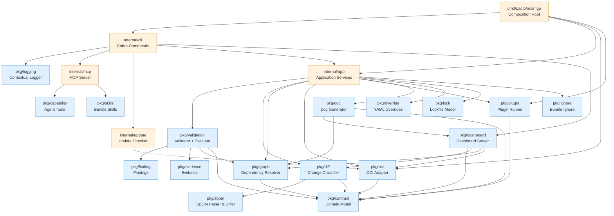

# Architecture

How the Pacto codebase is arranged, for contributors and plugin authors.
Dependencies flow in one direction.

**Four things stay apart, and this layout exists to keep them apart.** A
*contract* is declared operational intent. *Evidence* is what a collector
observed about a running system. `Evaluate` is a pure function that compares the
two and returns typed findings plus coverage. Everything else — the CLI, the
dashboard, the operator — is a surface. A contract adds a relational and temporal
layer over the interface specs it composes rather than replaces: ownership,
dependencies, compatibility, readiness. That layer is why the core splits into
`pkg/graph` (dependencies), `pkg/diff` (compatibility and change over time) and
`pkg/validation` (structural enforcement and evidence evaluation).

## Separation of concerns

The model keeps ten roles distinct.

| Concept | Where it lives | First-class type? |
|---|---|---|
| **Contract** — declared operational intent | `pkg/contract` `Contract` | Yes |
| **Bundle** — the contract plus the interface/config/policy/skill files it composes | `pkg/contract` `Bundle` (a `Contract` + `fs.FS`) | Yes |
| **Interface** — a composed spec (OpenAPI, AsyncAPI, gRPC) the service exposes | `pkg/contract` `Interface` (references a file in the bundle) | Yes |
| **Capability (contract)** — a declared observability capability: `health`, `metrics` or a namespaced `extension` | `pkg/contract` `Capability` | Yes |
| **Generated tool / skill** — an agent-facing *projection* of a bundle, not part of the domain model | `pkg/capability` `BuildTools` (tools from an OpenAPI interface); `pkg/skills` (`skills/*.md`) | Projection, not a contract type |
| **Policy** — a JSON Schema that validates the contract itself | `pkg/contract` `Policy`; resolved and enforced in `pkg/validation` | Yes |
| **Evidence** — a runtime observation, external to the contract | `pkg/evidence` `Observation` / `EvidenceSet` | Yes |
| **Evaluation result** — typed findings plus coverage | `pkg/finding` `Finding`; `pkg/validation` `Coverage` | Yes |
| **Collector** — turns a real system into evidence | any component producing a valid `EvidenceSet` (`pkg/evidence`); first party: the runtime watcher (`internal/runtimewatch`, behind `pacto run` and `pacto agent`) and the Kubernetes collector in `integrations/kubernetes`, which merges the watcher's node agent output | No core interface — Evidence is the boundary |
| **Plugin / controller / external actor** — interprets a contract and acts through existing tools | `pkg/plugin` (out-of-process); controllers live in `integrations/*` | Boundary, not core logic |

## Dependency graph

The diagram shows the main edges, not every import: `pkg/catalog`, `pkg/fleet`
and `pkg/impact` are direct imports of both `internal/app` and `internal/mcp`,
`pkg/openapi` of `internal/mcp` alone, and all four are left out to keep it
readable. Dependencies flow
**downward only**. The OCI adapter (`pkg/oci`) is a public package, importable
by external consumers such as the Kubernetes operator in
`integrations/kubernetes`. So are the engine packages that operator consumes —
`pkg/contract`, `pkg/evidence`, `pkg/finding` and `pkg/validation` — none of
which import Kubernetes. The import-boundary gate
`tests/architecture/boundary_test.go` enforces both rules.

## Layers

| Layer | Location | Responsibility |
|-------|----------|----------------|
| **Core** | `pkg/` | Pure, reusable domain logic. No CLI dependencies, no side effects beyond minimal I/O. |
| **Application** | `internal/app` | Use-case orchestration. Each CLI command maps to one service method. Returns structured results (never prints). |
| **Interfaces** | `internal/cli`, `internal/tui`, `cmd/` | Thin adapters. Flag parsing, output formatting, process bootstrap. Zero business logic. |

Infrastructure adapters live in `internal/` because they depend on external
systems or framework-specific details.

| Package | Role |
|---------|------|
| `internal/mcp` | Model Context Protocol server for AI tool integration |
| `internal/k8sclient` | Shared, dashboard-independent Kubernetes access seam |
| `internal/fleetsrc` | Concrete, cluster-free `fleet.Source` implementations |
| `internal/evidenceoci` | Persists accepted evidence as OCI 1.1 referrers |
| `internal/runtimewatch` | Linux runtime watcher behind `pacto agent` and `pacto run`: eBPF socket collector (`ebpf/`), `/proc` scan, cgroup identity resolvers and sinks (`evalsink` evaluates on the host, `kubesink` writes `NodeRuntimeObservation`) |
| `internal/update` | Async GitHub version checking and self-update |
| `internal/testutil` | Shared mocks and fixtures (`MockBundleStore`, `MockPluginRunner`, `TestBundle()`) |

Per-package detail is not repeated here. `go doc ./pkg/...` is the reference,
and it cannot go stale.

## Collectors: evidence is the boundary

There is intentionally **no `pkg/collector.Collector` interface**. Different
environments need different collector inputs. The Kubernetes collector needs CR
bindings and temporal windows; another environment may need build results or
cloud resource identifiers. Forcing them through one speculative input signature
would either leak platform concepts into the core or be an abstraction only for
symmetry.

A collector feeds the engine by producing a `pkg/evidence` `EvidenceSet`, and
there is nothing else to implement. Concrete collector APIs live in their own
integrations (the Kubernetes observer is
`integrations/kubernetes/internal/observer`); the pure engine never imports
them. The runtime watcher follows the same rule. `internal/runtimewatch`
(kernel side in `internal/runtimewatch/ebpf`) turns socket events into a
platform-neutral snapshot; `pkg/runtimefacts` holds that snapshot, the workload
bindings and the pure verdicts that turn both into observations, and `pkg/probe`
the SSRF-safe health, metrics and protocol probes. `pacto run` and `pacto
agent --sink local|evidence` evaluate on the host through `evalsink`. The
Kubernetes node agent is only a configuration of the same agent: the operator's
DaemonSet runs `pacto agent --sink kubernetes` from the runtime image, which
publishes `NodeRuntimeObservation` objects, and the observer folds them into its
own `EvidenceSet` (`internal/observer/kernel.go`) with the same
`pkg/runtimefacts` verdicts. The engine sees one evidence set per target and no
new interface. `tests/architecture/collector_docs_test.go` fails if a `pkg/collector`
package reappears without a real implementation behind it.

## The OCI bundle cache key

`pkg/oci`'s `CachedStore` wraps any `BundleStore` with in-memory and disk
caching. One entry is
`~/.cache/pacto/oci/_v2/<escaped repository segments>/<escaped tag>/`, holding
`bundle.tar.gz` and a `ref.json` sidecar naming the reference that bundle came
from.

The reserved `_v2/` segment keeps the layout disjoint from the pre-injective one
it replaced. That older key spelled every `:` as `/`, so
`localhost:5000/demo/svc:1.0.0` and `localhost/5000/demo/svc:1.0.0` named one
directory and overwrote each other. Entries in the old layout are still read,
and are served only when their sidecar names the reference asked for; nothing is
written there any more.

## The dashboard

`pkg/dashboard` is the largest core package: an HTTP server, multi-source
aggregation, graph, compliance and an embedded single-page app, which the
operator also embeds.

Its HTTP server is built on [Huma v2](https://huma.rocks/) with typed I/O
structs and generated OpenAPI. Static files and CORS are served on the raw
`http.ServeMux`; only API operations go through Huma.

OpenAPI is the only wire truth. Huma generates the OpenAPI contract from the Go
handlers. The TypeScript request and response types are generated from that
contract into `pkg/dashboard/frontend/src/lib/generated/` and committed with a
do-not-edit notice. `make check-dashboard-sdk-drift` regenerates both and fails
on any diff. Handwritten frontend code may add ergonomics but must never
redeclare a wire field or build an `/api/...` URL by hand, because a third,
hand-maintained copy of the schema drifts silently.

## Delivery

Delivery is the opt-in part of Pacto that moves versions between
environments. It is Alpha, and it is the one part of Pacto that needs
Kubernetes.

| Package | Role |
|---|---|
| `pkg/delivery` | The pure core: the operation model, `plan()`, autonomy levels and trust. The decision path reads no cluster, registry or clock; its inputs arrive in `PlanInput` and through the `Registry` interface. The promoter, the CLI and the MCP tools all call it. |
| `pkg/deliveryrecord` | Where delivery records live in a registry: the stream anchor, the referrer annotations and the verified read. The recorder writes through it and every reader reads through it. |
| `integrations/kubernetes/internal/delivery` | The promoter and the recorder. The promoter carries each Operation from admission to conclusion and writes status. The recorder writes one signed record per concluded operation. Both ship in the separate `pacto-delivery` image. |
| `internal/app/delivery*.go` | The client side behind `pacto delivery`: plan, propose, approve, cancel, get, explain and the record history, against the cluster API and the registry. |
| `internal/mcp/delivery.go` | The `pacto_delivery_*` MCP tools. |

## Design principles

1. **Pure core** — `pkg/*` packages have zero CLI or Kubernetes dependencies and are reusable from any Go program
2. **Strict layering** — CLI → App → Core (`pkg/`) → Domain (`pkg/contract`)
3. **Declaration separated from observation** — the contract is stable intent (`pkg/contract`); runtime facts are separate evidence (`pkg/evidence`) collected outside the core. The pure `Evaluate` function in `pkg/validation` reasons over both and never observes or acts itself
4. **No global state** — every instance is created in the composition root (`main.go`); even the logger is built per invocation and carried on the command context (`pkg/logging`), never installed as a process global
5. **Interface-based** — engines depend on interfaces (`BundleStore`, `ContractFetcher`), not concrete implementations
6. **Out-of-process plugins** — language-agnostic, version-independent
7. **Embedded schemas** — JSON Schema compiled into the binary
8. **Deterministic validation** — the same contract, schema and resolved policies always give the same result
9. **Compose, do not replace** — Pacto never defines a schema language of its own; the contract adds only the relational and temporal layer no single interface owns
10. **Two projections, shared readers** — a bundle is projected twice, on purpose. `pkg/fleet` builds the live operational snapshot the dashboard and the MCP fleet tools serve: many sources, bounded, no document bodies. `pkg/contractview` (`ServiceDetailsFromBundle`) builds the offline view of one bundle, bodies included, that the `pacto doc` Markdown renderer and the static HTML exporter render. What keeps them from drifting is the bundle readers they share: tool naming (`capability.ToolsForContract`, also behind MCP capability tools), lockfile reading (`lock.ReadFS`) and the docs walk (`contract.WalkDocs`)

## Architectural invariants

These rules must be preserved by future changes. Each exists for a specific
reason.

| Invariant | Rationale |
|-----------|-----------|
| `pkg/contract` imports nothing from the project | Foundation layer. If it depends on anything above, the entire dependency graph becomes circular. |
| `pkg/*` must not import `internal/cli` or `internal/app` | Core logic must remain reusable outside the CLI (operator, MCP, tests). |
| `pkg/oci` is a public package | OCI primitives (client, credentials, tag resolution) are importable by external consumers such as the Kubernetes operator. |
| `internal/app` methods are stateless | Options in, result out. No side effects beyond the operation itself. This makes testing and composition straightforward. |
| Validation is deterministic | Rules come only from the contract graph: the schema and the policies the contract resolves. The same contract, schema and resolved policies always give the same result. |
| `pkg/catalog` is framework-independent | It imports `pkg/contract`, go-digest and the standard library, and nothing else, so catalog semantics can never become a property of one delivery mechanism. |
| `pkg/fleet` is route-neutral | The operational graph owns canonical identities, query facts, completeness and limitations, and returns route-neutral entity references. Turning a reference into a navigable URL is a *transport* concern: the dashboard transport adds an href built from the canonical key through a single route builder. MCP and other non-dashboard consumers read the same facts and must never receive dashboard URLs. Enforced by `TestFleetStaysRouteNeutral` in `tests/architecture`. |
| Every assertion needs a possible Evidence path | An assertion no collector can produce Evidence for leaves a service permanently `Unknown`. This is why `verification.conformance` was removed: nothing produces interface-conformance Evidence, so declaring an `interfaces[]` entry requires runtime *availability* Evidence instead. Conformance can return once a real observation kind and evaluator exist for it — a schema field is not enough. |

## Where the "How Pacto decides" pages live in the code

The reader pages on pacto.run leave package names out. For contributors:

| Page | Code |
|---|---|
| [The model](docs/model.md) | `pkg/contract` (the `Contract` type), `pkg/evidence` (`EvidenceSet`), `pkg/validation/evaluate.go` (`Evaluate`); the runtime watcher in `internal/runtimewatch`, its facts in `pkg/runtimefacts` and its probes in `pkg/probe` |
| [Operational graph](docs/operational-graph.md) | `pkg/fleet`. The frozen view is the **Fleet Snapshot** and the query layer over it the **Fleet Query** |
| [Impact analysis](docs/impact.md) | `pkg/impact`, over `pkg/diff` and the `pkg/fleet` snapshot. It imports no Kubernetes, OCI, dashboard, MCP or HTTP code, so the CLI, the MCP tool and the dashboard return the same answer for the same snapshot |

## See also

- [The Pacto model](docs/model.md) — the engine, the compliance states and the
  ten roles this layout keeps apart
- [CONTRIBUTING.md](CONTRIBUTING.md) — build, test levels and the pull-request
  workflow
- [release/README.md](release/README.md) — the release transaction, the
  publishers and what to do when one stops part-way
