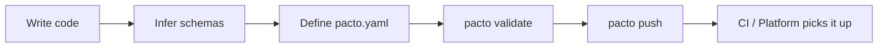

# Pacto for Developers

You own the service, so you own its contract. This guide shows how to write one next to your code: a `pacto.yaml` file that says what your service exposes, what it needs and how it behaves. Platform engineers, CI and other teams then read the same file instead of asking you.

New to Pacto? Start with the five-minute [Quickstart](quickstart.md). The
[CLI reference](cli-reference.md) lists every command and
[contract sections](contract-reference/sections.md) lists every field.

---

## Your workflow



### 1. Initialize your contract

```bash
pacto init my-service
```

This creates a `my-service/` directory (a *bundle*: the contract plus the files it points to) with a valid starter contract. Edit `pacto.yaml` to match your service.

### 2. Infer schemas from your code (optional)

If your config already ships a JSON Schema, such as your Helm chart's `values.schema.json`, vendor that file into your bundle and point `configurations[].schema` at it. Otherwise the `schema-infer` plugin generates one from a config file.

#### Generating a configuration schema

Pacto resolves the `--option file=` path relative to the **bundle directory**, so keep the config file inside the bundle. With `config.yaml` in `my-service/`:

```bash
pacto generate schema-infer my-service --option file=config.yaml -o my-service
```

This generates `my-service/config.schema.json`. Reference it in your contract:

```yaml
configurations:
  - name: default
    required: true
    schema: config.schema.json
```

!!! warning "Secret leak trap"
    The plugin leaves your `config.yaml` sitting in the bundle, and **a bundle
    directory is published whole**. `pacto pack` and `pacto push` upload every file
    under it, so `pacto pull` hands your config values, secrets included, to anyone
    who can read the artifact. The contract needs only the inferred schema. Delete
    the input once the schema exists, or list it in
    [`.pactoignore`](pactoignore.md) if you want to keep it beside the contract.

#### Generating an OpenAPI spec

If your service exposes an HTTP API using FastAPI or Huma, use the `openapi-infer` plugin to extract an OpenAPI 3.1 spec from your source code:

```bash
# Auto-detect the framework: FastAPI or Huma (generates interfaces/openapi.yaml)
pacto generate openapi-infer my-service -o my-service

# Override framework detection
pacto generate openapi-infer my-service -o my-service --option framework=fastapi
```

Both plugins live in a separate repository and ship as separate binaries. The installer script fetches them alongside the CLI; `go install` and `make build` build only `pacto`. See [Official plugins](plugins.md#official-plugins) for how to get them.

### 3. Define the contract

See [Contract sections](contract-reference/sections.md) for interfaces, workload, state and capabilities; [Dependencies and state](contract-reference/dependencies-and-state.md) for dependencies; and [Configuration and policy](contract-reference/configuration-and-policy.md) for configurations and policies.

### 4. Validate and push

```bash
pacto validate my-service
pacto push oci://ghcr.io/your-org/my-service-pacto -p my-service
```

See [Validation layers](contract-reference/validation.md) for the rules and error codes. `push` validates before uploading; use `--force` to overwrite an existing tag.
`pacto push` uploads only the contract, for use without delivery. For anything
delivery should ship, use [`pacto publish`](publishing.md), which signs the
version and never overwrites one.

On Kubernetes, the [operator](integrations/kubernetes/overview.md) checks what your service does on the network against this contract. See [runtime conformance](integrations/kubernetes/runtime-conformance.md).

---

## What's next

- [Contract reference](contract-reference/index.md): every field, precisely
- [Composition patterns](patterns/index.md): the compositions these primitives
  are usually assembled into
- [CLI reference](cli-reference.md): every command and flag
- [For platform engineers](platform-engineers.md): the other side of the same
  contract
