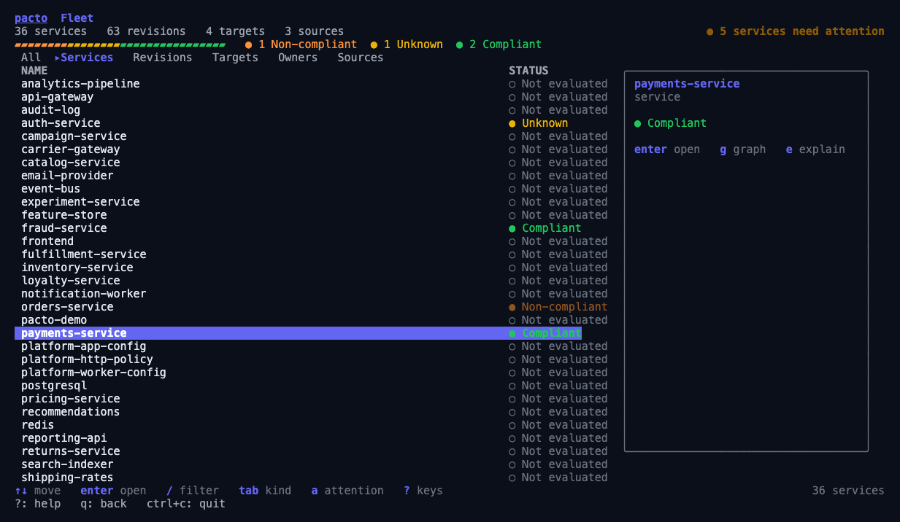

# Fleet views

Three ways to see all your services at once: the dashboard in a browser,
`pacto fleet` in a terminal or CI job and `pacto tui` in an interactive
terminal. All three read the same [operational graph](operational-graph.md),
the joined view of your contracts, their versions and where they run. An AI
agent asks the same questions through the `pacto_fleet_*` tools of
[`pacto mcp --fleet`](mcp-integration.md).
The contract-to-infrastructure side is in [For platform
engineers](platform-engineers.md).

## Dashboard

`pacto dashboard` opens a web dashboard over the same contracts the CLI manages
and the operator checks. It has four views: what needs attention now, the
service list, the [Operational Graph](operational-graph.md) and change
analysis. It finds its sources at startup and merges them per service. Next to
the Kubernetes operator it needs no OCI arguments: it reads the registry
addresses from the `resolvedRef` field in each Pacto resource's status, then
shows version history, interfaces, configuration schemas and diffs. See the [`pacto dashboard`
reference](cli-reference.md#pacto-dashboard) for its flags and environment
variables. [The service page](dashboard-service-page.md) describes what a
service's page shows and how it says what Pacto does not know.


Its HTTP API is described at `/openapi.json`; see [Dashboard container](dashboard-docker.md#operational-endpoints).

## Fleet queries without a browser

`pacto fleet` answers the same questions from a terminal or a CI job: it builds
one snapshot from the sources you name, then queries it with `search`, `get`,
`graph`, `status` and `explain`. `entities`, `entity` and `attention` list
owners, business domains and offerings, inspect one of them and list what
needs attention, most severe first. [Ask questions about your
organization](ask-your-organization.md) maps common questions to these
commands. `pacto fleet neighborhood <service>` lists who a service depends on
and who depends on it, with their owners, and `--mira-source <url>` adds the
calls a Mira node saw as observed edges. `pacto fleet versions <offering>`
lists each provider's versions of a platform offering and, with `--range`,
which satisfy it, and `pacto fleet entities --consumes <offering>` lists the
services that consume it. `pacto fleet entity offering <slug>` shows each
consumer's [provisioning status](platform-offerings.md#provisioning-status).

[Golden paths](golden-paths.md) have their own filters:

- `pacto fleet entities --template` lists golden paths, and
  `--template=exclude` leaves them out;
- `pacto fleet entities --created-from <key>` lists the services created from
  one golden path, `(none)` those that declare no origin and `(unresolved)`
  those whose origin resolves to no golden path; `--sort created` ranks golden
  paths by the services created from them;
- `pacto fleet search --template` filters a search the same way;
- the MCP tools take `template` and `created_from`, and the dashboard lists
  golden paths on its Golden paths page.

```bash
$ pacto fleet search --local ./contracts --oci ghcr.io/acme/unreachable-pacto:1.0.0
1 of 1 service(s):
  payments-api                 NotEvaluated owner=acme/payments  domain=-            offering=-            revs=1 targets=0
warning: answer is partial (as of 2026-08-23T01:30:40+02:00)
  - [SOURCE_PARTIAL] source oci returned a partial result
  - [SOURCE_RECORD_INVALID] ref ghcr.io/acme/unreachable-pacto:1.0.0 could not be resolved: artifact not found: ghcr.io/acme/unreachable-pacto:1.0.0
```

**Read the completeness before you read the rows.** Pacto reports an unreachable
registry, so a service missing from a `partial` answer may be one the missing
source knew about. Likewise `1 of 1` is *this page* of `total` matches. `--output-format json` carries the
same facts in a `meta` envelope for a CI job to branch on, and
[query semantics](operational-graph-reference.md#query-semantics) has the five operations
and the [knowledge vocabulary](operational-graph.md#knowledge) behind
`completeness`.

## One question, three surfaces

A person and an agent ask the same question in the same words. Each row names
the command, the [MCP tool](mcp-reference.md) and the dashboard API route
that answer it; a flag, a tool argument and a route parameter with one meaning
carry one name. A dash marks a surface that does not answer the question, and
the note says where that answer lives instead.

| Question | CLI | MCP tool | Dashboard route | Note |
|---|---|---|---|---|
| Which owners, domains, offerings or services match? | `pacto fleet entities` | `pacto_fleet_entities` | `GET /api/fleet/entities` | |
| What is this service, revision, owner, domain or offering? | `pacto fleet entity` | `pacto_fleet_entity` | `GET /api/fleet/entities/{kind}` | |
| What needs attention? | `pacto fleet attention` | `pacto_fleet_attention` | `GET /api/fleet/attention` | |
| Who depends on this service, and on whom does it depend? | `pacto fleet neighborhood` | `pacto_fleet_neighborhood` | `GET /api/fleet/neighborhood` | |
| Which services match this text or filter? | `pacto fleet search` | `pacto_fleet_search` | `GET /api/fleet/services` | |
| How is the fleet doing? | `pacto fleet status` | `pacto_fleet_status` | `GET /api/fleet/status` | |
| What does the overview show? | - | - | `GET /api/fleet/overview` | Dashboard only |
| What is this service or target? | `pacto fleet get` | `pacto_fleet_get` | `GET /api/fleet/service`, `GET /api/fleet/target` | |
| What is this service's dependency tree? | `pacto fleet graph` | `pacto_fleet_graph` | `GET /api/fleet/services/{name}/graph` | |
| Why does Pacto say this? | `pacto fleet explain` | `pacto_fleet_explain` | - | The dashboard explains on its entity pages |
| Which versions of this offering exist? | `pacto fleet versions` | `pacto_fleet_versions` | `GET /api/fleet/versions` | |
| What does a document in this revision say? | `pacto doc` | `pacto_fleet_revision_document` | `GET /api/fleet/revisions/document` | The CLI reads the bundle itself |
| What is the whole read model? | `pacto fleet snapshot` | - | `GET /api/fleet/snapshot` | MCP answers through the fleet tools |
| Which consumers does this change affect? | `pacto impact` | `pacto_impact` | `GET /api/fleet/impact`, `POST /api/fleet/impact` | Over HTTP and on a shared dashboard, only revisions in your view |
| What does this server serve? | - | `pacto_capabilities` | `GET /api/capabilities` | The CLI runs every command as the local user |
| Who am I to delivery? | `pacto delivery caller` | `pacto_delivery_caller` | `GET /api/delivery/caller` | |
| What waits on me? | `pacto delivery inbox` | `pacto_delivery_inbox` | `GET /api/delivery/inbox` | |
| Which environments run which version? | `pacto delivery environments` | `pacto_delivery_environments` | `GET /api/delivery/environments` | |
| How far is each Stage from autonomy? | `pacto delivery autonomy` | `pacto_delivery_autonomy` | `GET /api/delivery/autonomy` | |
| Which versions do the Stages know, and are they signed? | `pacto delivery published` | `pacto_delivery_published` | `GET /api/delivery/published` | |
| Which publishes did Pacto refuse? | `pacto delivery refusals` | `pacto_delivery_refusals` | `GET /api/delivery/refusals` | |
| Where is this service in delivery? | `pacto delivery status` | `pacto_delivery_status` | `GET /api/delivery/progress` | Progress is status with `--why` (`why` in MCP) |
| What happened on this Stage? | `pacto delivery history` | `pacto_delivery_history` | `GET /api/delivery/history` | |
| Who put this digest there? | `pacto delivery blame` | `pacto_delivery_blame` | `GET /api/delivery/blame` | |
| Which versions may this Stage take? | `pacto delivery candidates` | `pacto_delivery_candidates` | - | The dashboard lists them in its propose panel |
| What does this delivery record say? | `pacto delivery record get` | `pacto_delivery_record_get` | `GET /api/delivery/record` | |
| Does this delivery record verify? | `pacto delivery record verify` | `pacto_delivery_record_verify` | - | The dashboard verifies on its record page |
| Where is this operation? | `pacto delivery get` | `pacto_delivery_get` | `GET /api/delivery/operations/{namespace}/{name}` | |
| Why is this operation where it is? | `pacto delivery explain` | `pacto_delivery_explain` | - | The dashboard explains on its operation page |
| How would I undo this operation? | `pacto delivery undo` | `pacto_delivery_undo_plan` | `GET /api/delivery/undo` | |
| Where is this service in its lifecycle? | `pacto delivery lifecycle` | `pacto_delivery_lifecycle` | `GET /api/delivery/lifecycle` | |
| Which operation types exist? | `pacto delivery describe` | `pacto_delivery_operation_types` | - | The dashboard's propose panel lists them |
| What would this operation do? | `pacto delivery plan` | `pacto_delivery_operation_plan` | `POST /api/delivery/plan` | |
| Propose this operation | `pacto delivery propose` | `pacto_delivery_operation_propose` | `POST /api/delivery/operations` | |
| Cancel this operation | `pacto delivery cancel` | `pacto_delivery_cancel` | `DELETE /api/delivery/operations/{namespace}/{name}` | |
| Answer this operation | `pacto delivery approve` | - | `POST /api/delivery/operations/{namespace}/{name}/decision` | People answer; MCP has no approve tool |
| Create a contract | `pacto init` | `pacto_create` | - | The dashboard writes no contract files |
| Edit a contract | - | `pacto_edit` | - | People edit `pacto.yaml` and run `pacto validate` |
| Is this contract valid? | `pacto validate` | `pacto_check` | - | The dashboard validates nothing |
| What may a contract say? | - | `pacto_schema` | - | The JSON Schema is published with the docs |

For one fleet, the three surfaces return the same `asOf`, `completeness`,
`limitations` and unknown counts. The dashboard, and MCP with `--dashboard-url`,
also add `href` links to dashboard pages.

## The terminal UI

`pacto tui` is the dashboard's terminal equivalent, built over the snapshot
`pacto fleet` builds and taking the same source flags. It loads that snapshot
once and opens on the Services tab. From there you move through services,
revisions, targets, owners and sources, with whatever row is highlighted standing
in as the argument, so you never type a path. It needs an interactive terminal;
in a pipeline, use the plain commands.

One difference from the dashboard matters more than the rest: **the dashboard
only reads and the TUI also writes.** Read verbs run in-process against the loaded
snapshot. Write verbs shell out to this same binary so they own the terminal.
Each one names what it is about to change before it waits for a `y`: the
directory a pull will overwrite, the resolved plugin binary, the output directory
a generate will write. Pass `--read-only` to remove the four write verbs from
the in-TUI help screen.

```bash
# whatever bundles are under the current directory
pacto tui

# a populated screen from the committed demo fixture
pacto tui --local examples/demo/bundles \
  --target-state examples/demo/fleet-targets.yaml \
  --traces examples/demo/traces.json --freshness 24h

# the same demo with no clone at all, straight out of the registry
pacto tui --root oci://ghcr.io/trianalab/pacto/pacto-demo:1.0.0 --local ""
```

The second command needs a clone and a paste from the repository root; it opens
on 37 services, a golden path and 4 operational targets. The third needs nothing on disk:
`--root` follows the published contract's dependency declarations and pulls 12 of
the demo's 38 services out of `ghcr.io`, and `--local ""` switches off the default
directory scan. A registry has no record of where anything runs, so every
service reads `NotEvaluated` until you add the `--target-state` fixture.



### Keys

| Key | Action |
|-----|--------|
| `tab` / `shift+tab` | cycle the tabs: kinds on the list, categories under `a`, direction on a graph |
| `/` | filter; `enter` applies it, `esc` discards what you typed |
| `enter` | open the highlighted row |
| `a` | what needs attention |
| `+` / `-` | graph depth |
| `?` | toggle the key table for the current screen |
| `r` | reload the snapshot |
| `q` | back, or quit from the root screen |
| `esc` | clear an applied filter, otherwise the same as `q` |
| `y` | copy the equivalent `pacto` command |
| `v` | validate the selected bundle |
| `E` / `e` | explain the bundle, or explain it from the fleet's point of view |
| `l` | check the lock file |
| `d` / `i` | diff or impact between two selections, pressed twice |
| `g` | the selection's neighborhood graph |
| `p` / `P` | push, or pull (writes; asks first) |
| `L` | rewrite the lock file (writes; asks first) |
| `G` | run a generate plugin (writes; asks first) |

`y` copies the command you would have typed to the clipboard, so you can run
anything the TUI has no key for. The line is shell-quoted, so a value
carrying a space or a semicolon still pastes as one argument. With no clipboard, for example over
`ssh` or on a headless box, the TUI prints the line and the reason it could not
copy it. See the [`pacto tui`
reference](cli-reference.md#pacto-tui) for every flag.
