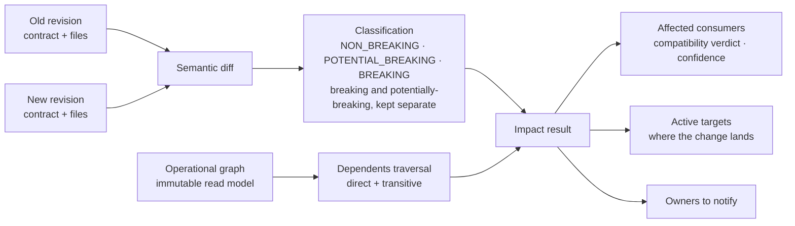

# Impact analysis (`pacto impact`)

Impact analysis answers the question a reviewer asks before merging: *if this
revision ships, who is affected?* Give it the old and new contract and it lists
the services that depend on this one, whether each still works with the new
version, where they run and who owns them.

```bash
pacto impact ./payments-api@1.4.0 ./payments-api@2.0.0 --local ./services
```

It joins two things Pacto already has. The semantic diff says *how* the contract
changed ([change classification](contract-reference/diff.md)). The
[operational graph](operational-graph.md) says *who depends on the service and
where it runs*. The CLI command, the MCP tool and the dashboard's
**Change analysis** workspace run the same analysis and, given the same
snapshot, return the same answer.

## Diff × graph → impact



A change can break consumers while every spec stays identical, such as an
amount switching from cents to euros. Raise the interface's
[`compatibilityEpoch`](contract-reference/sections.md#compatibility-epoch) and
the diff classifies the revision `BREAKING`, so its consumers are listed.

The diff is computed once over the old→new revision. The changed service is then
looked up in the graph and traversed in the **dependents** direction, direct and
transitive. Each dependent becomes an *affected consumer*, annotated with the
evidence Pacto has for that edge, and the result rolls up the **active
targets** the change would land in and the **owners** to notify.

Every answer inherits the snapshot's `asOf` time, `completeness` and
`limitations`, so a partial fleet always reads as partial. When no fleet source
holds the changed service, `pacto impact` adds the new revision to the snapshot
so the services that depend on it are found, and the answer carries
`newRevisionAdded: true`. A snapshot it cannot add to, such as the dashboard's
published snapshot, answers with a `SERVICE_NOT_IN_FLEET` limitation, no
consumer list and an `unverified` gate.

## What an affected consumer carries

For each dependent the analysis records:

| Field | Meaning |
|-------|---------|
| **service / domain / owner** | Who is affected and who owns them. |
| **depth / direct / path** | `depth` is the shortest distance from the consumer to the changed service: 1 is a direct dependent and `>1` is transitive. A consumer that depends on the changed service directly is direct even when it also reaches it through another dependent. `path` is a shortest dependency chain from the consumer to the changed service. |
| **required** | Whether the consumer declared this dependency as required. |
| **compatibility** | The consumer's declared compatibility range against the changed service. |
| **compatibilityVerdict** | Whether the new version satisfies that range. `compatible` and `incompatible` both need a declared range *and* a range and version `semver` can parse; without all three the verdict is `unknown`, because an unreadable or absent range is uncertainty. |
| **provenance** | Where the edge came from: `declared`, `observed`, `declared+observed` or `inferred`. |
| **confidence** | How strongly the evidence supports the claim (see below). |
| **status / targets** | The consumer's aggregate status and the operational targets it runs in. |
| **unmet** | Each [guarantee](contract-reference/dependencies-and-state.md#required-guarantees) the consumer requires that the new version does not meet, with both values. |
| **note** | A plain-words qualifier. On a `BREAKING` change a `compatible` verdict only means the range accepts the new version, so the note says to check that the consumer does not use what the change removes. An open range such as `>=1.0.0` accepts every new major version, and the note says so. |

### Confidence model

Confidence grades how strongly the available evidence supports each
affected-consumer claim.

| Confidence | Exact meaning |
|------------|---------------|
| **contractual** | A declared dependency **with** a usable compatibility range. The consumer's own contract says it depends on this service and pins the versions it accepts. |
| **declared** | A declared dependency **without** a usable compatibility range. The dependency is stated, but no version constraint was pinned, so Pacto cannot compute a compatibility verdict. |
| **observed** | Runtime use of the dependency was observed in a window. Requires `--include-observed`. |
| **corroborated** | The declared dependency and an observed one agree. This is the strongest grade: contract and runtime say the same thing. |
| **inferred** | A transitive effect reached *through* another affected service (`depth > 1`). It follows from the graph. |
| **unknown** | A direct edge with no declaration and no observation. The effect is possible but unverified. |

> **An inferred path is a lead to verify.** Pacto reaches a transitive consumer
> through the graph. It tells you where to *look*; confirm whether the consumer
> breaks before you act on it.
>
> **Observed evidence only raises confidence when you opt in.** Without
> `--include-observed` the analysis is declared-only. Runtime observations then
> let a direct edge become `observed` or `corroborated`.

A `partial` snapshot is incomplete knowledge, an `unknown` verdict is
uncertainty and an `inferred` consumer is a lead to verify.

Observed edges come from OpenTelemetry traces via `--traces <file>`. Beyond
corroborating declared consumers, traces surface **observed-only (shadow)
consumers**: services seen calling the changed service without declaring the
dependency. With traces they appear as direct consumers at `observed` confidence.

## CLI

```bash
pacto impact <old> <new> --local .
```

`<old>` and `<new>` are the two revisions to compare: bundle paths or refs. They
are separate from the fleet snapshot and may be `oci://` references either way.

`pacto impact` reads the fleet through the same
[source flags](operational-graph-reference.md#sources) `pacto fleet` does, `--local`
included, which defaults to `.`. Point it only at offline sources and the whole
analysis stays offline.

Turn on runtime corroboration with `--include-observed`, or supply an OTLP/JSON
trace export with `--traces`, which implies it:

```bash
pacto impact ./payments-api@1.4.0 ./payments-api@2.0.0 \
  --local ./services \
  --traces ./traces.json
```

The output reports the classification, then the breaking and potentially-breaking
changes in separate lists, so a potential break never counts as a confirmed one.
It then lists each affected consumer with its owner, verdict and confidence, the
active targets and a warning when the snapshot is partial. The JSON output also
carries `owners` and `completeness` as fields.

Pacto finds consumers only in the sources you pass. With `--local` alone it
sees only the contracts in those folders. A `BREAKING` change that none of them
depends on ends `clear` and exits `0`, so `No affected consumers.` covers only
those folders.

### Release gate and exit status

Every answer ends in a release gate, `gate`, with the reason in `gateReason`.
The CLI exits on it, and the MCP tool returns it:

| `gate` | Exit | When |
|--------|------|------|
| `blocked` | `1` | The change is `BREAKING` and reaches a consumer that does not accept the new version, or has an `unmet` guarantee, and is *active*. |
| `unverified` | `2` | The change is `BREAKING` and nothing is shown to block it, but the answer cannot clear it: the answer is partial, or consumers depend on the service and none is shown to be safe. |
| `clear` | `0` | The change is not `BREAKING`, or the snapshot is complete and no service depends on the changed one. |

A command that could not run also exits `1`, with nothing on stdout.

**Active means the snapshot knows of somewhere that consumer is deployed**: at
least one operational target. Compatibility is a statement about contracts;
active is a statement about the world.

`unverified` exists because a breaking change with consumers is never safe by
default. A consumer can be incompatible on paper with no known target, declare
no range, or match only by range. `--local` bundles declare no targets, so a
declared-only run of a breaking change with consumers exits `2`:

```console
$ pacto impact ./api-v1 ./api-v2 --local ./fleet
Impact: api 1.0.0 -> 2.0.0
Classification: BREAKING
Breaking changes: 2
Potentially breaking changes: 0
Affected consumers (1):
  web                          direct     confidence=contractual  compat=incompatible owner=frontend
Release gate: unverified
unverified: the change is BREAKING and 1 consumer depends on api, but none is shown to be both incompatible and running. Review each consumer, and add a source that knows where services run (for example --target-state) to tell deployed impact apart
$ echo $?
2
```

Give the snapshot a source that knows where things run and the same command
blocks:

```console
$ pacto impact ./api-v1 ./api-v2 --local ./fleet --target-state ./targets.yaml
Impact: api 1.0.0 -> 2.0.0
Classification: BREAKING
Breaking changes: 2
Potentially breaking changes: 0
Affected consumers (1):
  web                          direct     confidence=contractual  compat=incompatible owner=frontend
Active targets (1): [production/kubernetes-workload/shop%2Fweb]
Release gate: blocked
breaking changes affect active consumers, which run on known targets and do not accept api 2.0.0: web
$ echo $?
1
```

#### Gating in CI

In CI that is one of two deliberate choices. Fail on any non-zero exit and an
unverified breaking change stops the job as a blocked one does. A promotion
pipeline that gates on *deployed* impact alone can treat `2` as a pass, as long
as the job supplies targets. Gate on the JSON instead (`--output-format json`,
then `classification == "BREAKING"`) and you gate on the contract alone, which
is what you want before anything is deployed. That JSON carries
`schemaVersion: pacto.dev/impact/v1`, the compatibility contract to branch on
before reading any other field.
[Put it in your repository](ci.md#on-every-pull-request-who-breaks) has a
pull-request step that gates on the JSON. The file `--target-state` expects is
documented under
[target-state fixtures](operational-graph-reference.md#what-a-target-state-fixture-looks-like).

## The MCP tool and the dashboard

Agents get the same analysis as the read-only `pacto_impact` MCP tool. It belongs
to the **fleet query**
[family](mcp-reference.md#three-tool-families-and-their-boundaries) and shares
that family's boundaries: it projects the operational graph. It is read-only and grants no permission.
It is the one fleet tool that rebuilds the graph on every call; the others serve
a frozen snapshot. Its `asOf`
therefore advances, while the `pacto_fleet_*` tools' stays at the value they were
started with. When the two disagree they describe the same system at two moments.

In the dashboard the analysis is one half of the **Change analysis** workspace,
served by `/api/fleet/impact`. It is entered from the service or revision you are
already looking at, and the analyzed pair is in the URL so the answer is
shareable. It opens on a one-line answer: what kind of change it is and who it
reaches. What changed, the affected consumers, owners and targets and the
evidence gaps are folded below it, each with its count. It reads the **currently published** snapshot, the same one the
Operational Graph shows, so its `snapshotId` matches the graph. The **include-observed** control is enabled only when the host
declares an observation source, because observed evidence needs a real source.

## What's next

- [The Pacto Operational Graph](operational-graph.md): the read model impact
  projects onto, and the knowledge vocabulary every answer carries
- [Change classification rules](contract-reference/diff.md): the semantic diff
  impact composes with the graph
- [MCP integration](mcp-integration.md): the fleet query tool family
  `pacto_impact` belongs to
