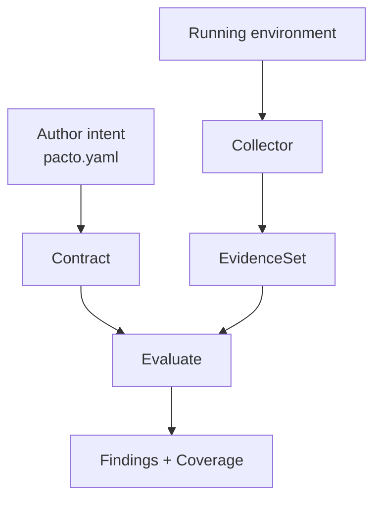
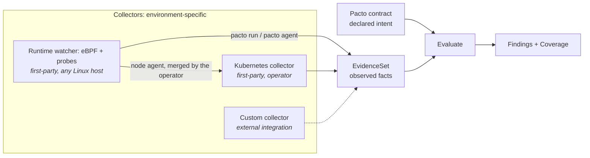

# The Pacto model

How Pacto decides whether a running service matches its contract. Three words
carry the whole page:

- A **contract** is what the service's authors say it is (`pacto.yaml`).
- **Evidence** is what a tool saw in the running system, such as "a pod listens
  on port 8080".
- A **collector** is the tool that gathers that evidence.

The engine compares the two and reports **findings**: one line per problem, each
with a code such as `INTERFACE_ABSENT`. One rule governs it: **a confirmed
contradiction is an error, and a check Pacto could not make is `Unknown`**.
Most of what follows keeps those two apart.

## Declaration versus observation

The contract records *intent*: what a service is, whatever platform runs it.
What it looks like at runtime is an *observation*, and it lives outside the
contract. A contract carries only intent. Ports, scaling, images and other
runtime settings belong to delivery and the integrations own them. Runtime facts travel separately, as an `EvidenceSet` produced by
a collector, and the engine reasons over the two together.



## The engine: `Evaluate(contract, evidence)` { #the-engine }

The heart of the system is a pure function, `Evaluate`:

```text
Evaluate(contract.Contract, evidence.EvidenceSet) -> ([]finding.Finding, Coverage)
```

It keeps no state. Each observation carries an `Outcome` the collector set
(`Observed`, `Failed`, `Stale` and so on), and the engine applies no timing,
network or Kubernetes logic of its own. An *assertion* is one thing the contract
claims, such as "the interface `public-api` is served". For each required
assertion (an interface's availability, a capability, a dependency, a
configuration, the workload or persistence), the engine looks for a matching
observation and produces exactly one of three results:

| Result | When | Finding |
|---|---|---|
| **Confirmed violation** | A matching observation has `Outcome=Observed` and its payload contradicts the contract. | `error`, category `RuntimeDrift`, for example `CONFIGURATION_ABSENT`, `CONFIGURATION_MISMATCH`, `INTERFACE_ABSENT`, `DEPENDENCY_UNREACHABLE`. |
| **Uncertainty** | No usable observation exists: missing, `Unsupported`, `Failed`, `Stale` or `Insufficient`. | `unknown`, category `Inconclusive`, for example `EVIDENCE_MISSING`, `COLLECTION_FAILED`. |
| **Satisfied** | A matching `Observed` observation is consistent with the contract. | None. |

A required assertion Pacto cannot observe never counts as a pass.
`Coverage` is the count of what the engine could check: it reports how many required assertions were evaluated versus declared.
`Coverage` leaves the aggregate compliance state unchanged, because a check
Pacto could not make is uncertainty.

## Compliance model { #compliance-model }

The compliance model consumers derive from these findings has four substantive
states, **Compliant**, **NonCompliant**, **Unknown** and **Invalid**, plus three
informational ones:

| State | Meaning |
|---|---|
| **Warning** | A non-blocking finding. |
| **Reference** | The contract declares no workload, so there is nothing to run and nothing to observe. |
| **NotEvaluated** | The contract declares a workload but was never runtime-evaluated *at all*. This is what an offline OCI, cache or local source looks like, and what `pacto doc`, `pacto fleet` and the dashboard report for a bundle read off disk or out of a registry. |

A workload that *is* being evaluated but has no usable evidence yet resolves to
`Unknown`. The two answer different questions: `Unknown` means "we looked and
could not tell" and `NotEvaluated` means "nothing has looked". The Kubernetes
operator reports only `Unknown`. `NotEvaluated` is in the CRD enum for parity with the engine (see [Kubernetes
limitations](integrations/kubernetes/limitations.md#notevaluated-is-reserved)).

## Collectors and the evidence boundary

A *collector* is any component that observes a real system and produces a valid
`EvidenceSet`. That `EvidenceSet` is the stable extension boundary. A collector
and a plugin extend Pacto in opposite directions: a plugin consumes a contract to
generate an artifact, and a collector observes a system to produce evidence.
You integrate a collector by producing an `EvidenceSet`.
A collector is never installed as a plugin.

Pacto ships one general runtime collector and plugs it into each platform. The
watcher observes TCP listeners and connection outcomes with eBPF and names the
workload behind each socket: a pod, a container, a systemd unit, a `pacto run`
session or a plain process. Its facts are platform neutral, and so are its
health, metrics and protocol probes. Three front ends put it to work (see [runtime
conformance](runtime-conformance.md)):

- `pacto run` wraps one command and evaluates it locally.
- `pacto agent` watches a host, binds workloads to contracts from Docker labels
  or a bindings file and evaluates them locally or sends signed evidence.
- The Kubernetes operator (`integrations/kubernetes`) deploys `pacto agent` on
  every node and merges what it publishes with its own Kubernetes collector,
  which reads the API server, into one `EvidenceSet`.

Every path ends in the same `Evaluate`. The "custom collector" box below is a
design extension point.



In-process, a custom Go collector builds an `EvidenceSet` (`pkg/evidence`) and
calls `Evaluate` (`pkg/validation`) directly. This is the compiled, run
`ExampleEvaluate` in `pkg/validation/collector_example_test.go`:

```go
// 1. The contract declares intent (loaded from a bundle in real use).
c := contract.Contract{
    Service:    contract.Service{Name: "orders", Version: "1.0.0"},
    Interfaces: []contract.Interface{{Name: "public-api", Type: "openapi", Ref: "interfaces/openapi.yaml"}},
}

// 2. A collector observes the environment and produces an EvidenceSet.
prov := evidence.Provenance{Collector: "example", DetectedAt: time.Unix(0, 0)}
ev := evidence.EvidenceSet{
    Subject:     evidence.SubjectRef{Kind: "service", Name: "orders"},
    ContractRef: "oci://example/orders:1.0.0",
    Source:      "example",
    ObservedAt:  time.Unix(0, 0),
    Observations: []evidence.Observation{
        evidence.NewInterfaceObserved(evidence.SubjectRef{Kind: "interface", Name: "public-api"}, "openapi", true, prov),
    },
}

// 3. The pure engine evaluates Contract x Evidence.
findings, coverage := validation.Evaluate(c, ev)
```

Across a trust boundary a remote environment reports a signed `EvidenceSet` over
the [evidence protocol](evidence.md) instead.

## Distinctions the model keeps

The model keeps each of these pairs apart. Merging a pair turns an uncertain
answer into a wrong one.

- **A requested reference and a resolved identity.** `payments-api:latest` is
  a question; `payments-api@sha256:…` is an answer. A tag is mutable, so resolve
  the reference before you treat it as exact content.
- **The same name in two domains.** Identity is domain-qualified, so two
  organizations that both run a `payments-api` stay two services. A repository
  basename or a path leaf is a label.
- **An exact revision match and retrievable content.** A target can pin a
  digest that names a revision unambiguously while that content sits in a
  registry Pacto cannot read. A feature that needs the content reports it as
  missing; a feature that needs only the identity works as usual.
- **Declared ownership and a canonical owner identity.** An owner identity
  carries both its kind and its value, so a team and a person who share a string
  stay separate. An email address is a contact for an owner.
- **Readiness and compliance.** Readiness is a team's own scored
  self-assessment of a revision. Compliance comes from evidence. A revision that
  passes every readiness check can run on a target that is non-compliant.
- **No evidence and evidence of absence.** Pacto records each observation as
  observed, unsupported, failed, stale or insufficient. "We could not look"
  and "we looked and it was missing" are different records.

## Scope

Pacto records what a service revision guarantees, so that people and tools can
compute against it. These limits hold for the contract engine and the operator.
The opt-in [delivery component](integrations/kubernetes/delivery.md) changes two
of them, as noted.

- **Pacto complements your developer portal and service catalog.** A portal
  decides what people see and a catalog lists services to browse. Pacto has no
  onboarding, scaffolding templates or golden paths.
- **Pacto publishes to the OCI registries you already run.**
- **Pacto models one service's operational intent.** Your databases, queues and
  networks stay in the tools that manage them.
- **Permissions stay with your runtime controls.** Pacto validates a contract
  against policy schemas. OPA, Kyverno, admission and IAM decide whether an
  action is *permitted*. Delivery adds its own admission policies, which decide
  who may move or approve a change to a Stage.
- **The engine reasons; collectors observe; actors act.** The engine reads only
  `Contract` and `EvidenceSet`. Delivery is one such actor: it picks the version
  a Stage runs, rolls back and freezes, and Flux or Argo CD applies it.
- **Reading a contract grants no permission.** Finding and reading a contract
  changes nothing and performs no action.

## The operational control loop

These roles compose into a loop a platform or an agent can drive. Steps 1, 2, 5
and 6 are implemented here: the CLI, the dashboard, the collector and
`Evaluate`. Steps 3 and 4 belong to systems you already run.

1. **Declare.** A contract states the service's identity, interfaces, capabilities, configuration, dependencies and policies.
2. **Read.** A platform, a controller or an agent inspects the contract (`pacto explain`, the dashboard API or generated tools over MCP).
3. **Constrain.** *(External.)* Policies, permissions, admission and IAM decide which actions are allowed.
4. **Act.** *(External.)* Controllers, deploy systems, plugins or agents act through existing infrastructure.
5. **Observe.** Collectors obtain runtime evidence from the real system and produce an `EvidenceSet`.
6. **Evaluate.** `Evaluate(contract, evidence)` reports whether observed reality is consistent with the declared contract.

## What's next

- [The Pacto Operational Graph](operational-graph.md): the read model over many
  such evaluations, and the vocabulary for how much of the world an answer saw
- [Validation layers](contract-reference/validation.md): whether a contract is *valid*, a separate question from whether it *matches reality*
- [Evidence protocol](evidence.md): reporting a signed `EvidenceSet` across a trust boundary
- [Impact analysis](impact.md): the confidence model over a change
