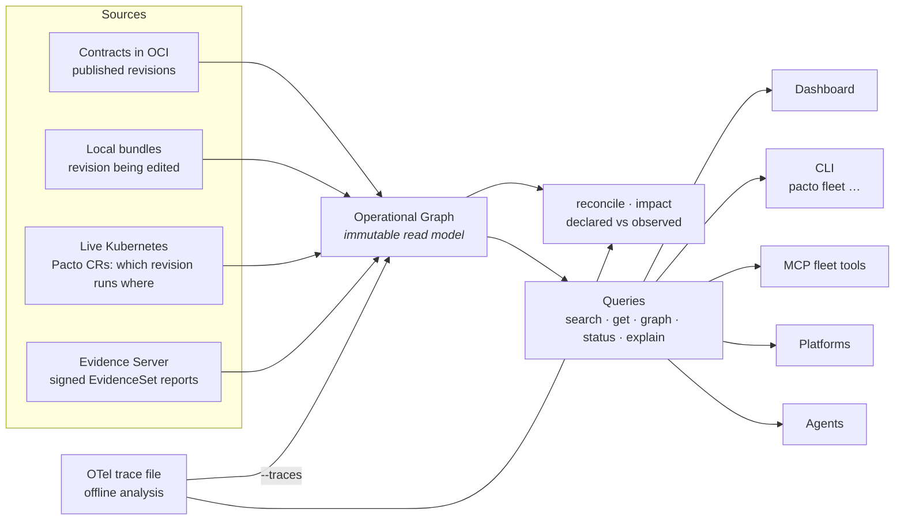
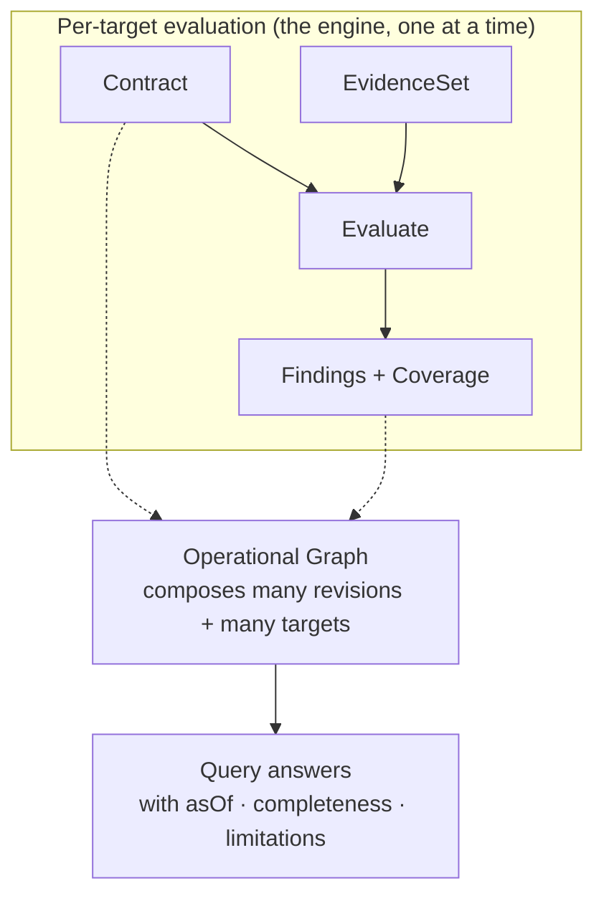

# The Pacto Operational Graph

The operational graph answers questions that span many services: *what depends
on payments-api, which revision runs in `production-eu`, is any of it failing its
contract and how sure are we?* It joins contracts, their published revisions and
the places they run into one view that people, CLIs, platforms and agents can
query.

```bash
pacto fleet search                                     # services found under .
pacto fleet graph payments-api --direction dependents  # who depends on it
pacto fleet status                                     # what needs attention
```

The graph is read-only. It collects results that other parts of Pacto produce.

## Three identities

The graph models three distinct things and keeps them separate: a name, a
revision and a running instance answer different questions.

| Identity | What it is | Example |
|----------|-----------|---------|
| **Logical service** | A stable name and owner. It has revisions and runs in targets. | `payments-api` (owner: payments) |
| **Contract revision** | An immutable resolved revision. Identity is the service plus a content digest: the source's immutable digest, or one derived from the whole bundle when the source has none. A ref or a version is never an identity. Pacto omits a revision that it can neither pin nor hash. | `payments-api@sha256:…` |
| **Operational target** | A concrete place a revision runs, generic as `scope/kind/name`. | `production-eu/customer-a → kubernetes-workload payments/payments-api` |

### How certainly a target is matched to a revision

A target can exist before Pacto knows which revision it runs, so every target
records **how** the link was made.

| Match | What Pacto knows |
|-------|------------------|
| `exact` | The target's content digest matches a revision's. Authoritative: this is the revision running there. |
| `inferred` | A *unique* correlation by mutable tag or version suffix. Probably right, but unproven. |
| `ambiguous` | Several revisions match that mutable reference. Pacto makes **no link**, and the target carries a `REVISION_LINK_AMBIGUOUS` limitation. |
| `unresolved` | Nothing matched, or the target's identity contradicts itself. No link, and a limitation on the target saying so. |

The bottom two sit on the target itself, so a consumer can classify a link without
parsing snapshot-level messages. The two read surfaces spell it differently, and
the CLI's spelling has a trap:

- **Snapshot and `pacto fleet get --target` JSON** carry `revisionMatch`, which
  is `omitempty` and only ever `exact` or `inferred`. **An absent
  `revisionMatch` is the finding**: it means ambiguous or unresolved. Read the
  target's `limitations` to learn which.
- **The entity-detail API** (`GET /api/fleet/entities/target?key=…`, what the
  dashboard reads) carries `linkState`, always present, with all four values.

This `inferred` differs from the `inferred` relationship provenance below: one is how a *target* was matched to a revision, the other how an *edge*
was derived.

## Relationships: declared, observed, inferred

Each edge carries a **provenance** discriminator that records where the fact came from:

- **declared**: from a contract (`dependencies[]`, and config/policy `ref`s).
- **observed**: seen in running traffic. Pacto keeps observed edges in their own
  adjacency index, so declared and observed answers stay separate.
- **inferred**: deduced heuristically. Reserved for future use; Pacto produces none yet.
- **declared+observed**: one edge backed by both. The neighborhood projection
  merges the two indexes for display and emits this combined value, so a consumer
  branching on provenance must handle all four.

The dashboard's Operational Graph draws each edge by what backs it: matched,
expected but not observed, or observed but not expected.


## Sources and queries

The graph is assembled from sources, each contributing what it can see right
now: contracts in your registry, local folders, live Kubernetes, the Evidence
Server and target-state files. It answers five kinds of question (search, get,
graph, status and explain). The
[operational graph reference](operational-graph-reference.md) lists every
source, the target-state file format, the query semantics and the canonical
owner key.

## Knowledge

Every Pacto answer records how much of the world it saw. Each word below is a
separate claim.

| Word | Claim |
|------|-------|
| **complete** | Every source answered. Nothing is missing. |
| **empty** | Every source answered and there is genuinely nothing. This is *complete* knowledge of an empty result. |
| **partial** | At least one source was unavailable, stale or itself partial. What you see is a floor. |
| **stale** | Every source answered, but one of them last saw the world a while ago. Its records are real and may have moved on since. |
| **unavailable** | A source did not answer at all. Whatever it knows is missing from this answer entirely. |
| **unknown** | No completeness value arrived. This differs from empty. |

Three of these travel on the wire, in every answer's `meta.completeness`:
`complete`, `partial` and `empty`. The other three are a consumer's reading of the
same envelope: `stale` and `unavailable` come from the per-source health reported
alongside it, and `unknown` is what is left when no envelope arrived at all. The
dashboard takes the worst of the six and gates every all-clear on that, so a
source that is down shows even when the snapshot calls itself complete.

**An unavailable source means missing data.** A partial answer with zero rows
is a set Pacto could not finish building.

## Organizational health and knowledge

Unknown is never a pass: Pacto reports what it cannot see as unknown and never
counts it as healthy.

The dashboard overview, `pacto fleet overview` and the MCP tool
`pacto_fleet_overview` return one answer to "how healthy is the organization
and how much do we know?". Pacto computes no score from it. Each count opens
the list of exactly what it counts, and every partition keeps its own unknown
bucket.

### Three questions about a target

Each operational target answers three questions separately:

| Question | Answer | Where |
|----------|--------|-------|
| Does it obey its contract? | `Compliant`, `NonCompliant`, `Unknown` and the other compliance states | `compliantTargets` and its siblings |
| Is its own health check passing? | Healthy, Failing, Unknown or Not observed | `operationalHealth` |
| How recently did we look? | Fresh, stale or never observed | `evidence` |

A target is **Failing** when its declared health check answered and reports it
is not healthy. The source records the finding `HEALTH_FAILING`, and compliance
stays `Unknown`: a failing check neither satisfies nor contradicts the
contract. A target is **Unknown** when Pacto cannot tell, for example because
no evidence arrived or the evidence is stale. A target is **Healthy** only when
its contract revision declares a health check, a source evaluated it on fresh
evidence and no finding names it. **Not observed** means the revision declares
no health check.

In the demo, the `gift-cards` target is Failing and its compliance is
`Unknown`. The `audit-log` target is Compliant on evidence older than the
freshness window, so it stays Compliant, counts in `staleCompliantTargets` and
its health is Unknown. The dashboard draws stale Compliant targets hatched.


### What the contracts leave out

Knowledge partitions the services that are no golden path into Described, With
gaps and Unknown. A service is Described only when Pacto read its current
contract and the documents it names and nothing is missing. The gaps are:

- **No summary**: no revision declares `service.summary`;
- **No domain**: the service has no business domain;
- **No interface document**: an interface declares no document. A declared
  document Pacto could not read is unknown, never a gap;
- **No readiness assessment**: the current revision carries none;
- **Runs nowhere**: the service has no operational target. Pacto counts it
  only when every target source is available and your view sees every target;
- **Unverified capability**: the current revision declares an extension
  capability that no evaluator verifies.

A service whose contract or interface document Pacto cannot read, whose
summaries conflict or whose placement Pacto cannot see is Unknown, and its
attention item names the cause.

Ownership keeps two cases apart. **No declared owner** means Pacto read the
contracts and none declares an owner. **Owner unknown** means Pacto cannot read
the contract, so it cannot tell whether an owner is declared.


The [tallies reference](operational-graph-tallies.md) lists every field.

## Who consumes it

A human portal and an agent consume the *same* graph.



- **Dashboard**: the visual front door. It builds one snapshot from every source
  it detects and serves the graph and change analysis through `/api/fleet/*`.
  The endpoints the UI reads (overview, entities, neighborhood and attention)
  carry their own `schemaVersion`, `pacto.dev/fleet-product/v1`, so a UI
  versions independently of the `pacto.dev/fleet/v1` snapshot export above. The
  Operational Graph view offers three **perspectives** (Services, Revisions and
  Operational targets) and a **Knowledge** control (Expected · Observed ·
  Differences). An operational target links to the dependency *service* it
  depends on. It draws no target-to-target mesh, because the snapshot has not
  observed that runtime routing. [The service page](dashboard-service-page.md)
  gathers one service's owner, contract, dependencies, targets, delivery and
  signatures.
- **CLI (`pacto fleet …`)**: the five queries on the command line, plus
  `overview` for the organization in one answer, `entities`, `entity` and
  `attention` for owners, domains, offerings and what needs attention,
  `neighborhood` for the services around one service, `versions` for an
  offering's versions and `reconcile` and `snapshot`. Scriptable,
  deterministic output.
- **MCP fleet tools**: `pacto_fleet_search`, `pacto_fleet_get`,
  `pacto_fleet_graph`, `pacto_fleet_status`, `pacto_fleet_explain`,
  `pacto_fleet_overview`, `pacto_fleet_entities`, `pacto_fleet_entity`,
  `pacto_fleet_attention`, `pacto_fleet_neighborhood`, `pacto_fleet_versions`
  and `pacto_fleet_revision_document`, plus
  [`pacto_impact`](impact.md), give an agent read-only understanding of the
  operational system. See [MCP integration](mcp-reference.md#three-tool-families-and-their-boundaries)
  for how they differ from authoring tools and generated service tools.

## A read model around many evaluations

Compliance is the pure `Evaluate(Contract, EvidenceSet)` function producing
findings for one service in one environment (see [the Pacto
model](model.md#the-engine)). The graph is the read model *around* many such
evaluations. It references each target's findings and coverage as the engine
produced them.



The graph also maintains a reverse-dependency index, which is what
[impact analysis](impact.md) traverses to answer "if this revision ships, which
consumers are affected, directly and transitively".

## Observed dependencies and reconciliation

Declared intent is half the picture; the other half is what traffic does.
The **OTel observer** (`pacto otel observe <traces.json>`) is an offline analyzer:
it reads an exported OTLP/JSON trace file and derives the caller-to-callee edges
its outbound spans prove. A missing span is no proof that a dependency is absent, so the observer reports only edges it saw. It can also
emit signable EvidenceSets (`pacto otel observe --evidence`) so observed
dependencies travel the same [evidence protocol](evidence.md) as any
other report.

Those observed edges meet the declared graph in three places:

- **The snapshot itself**: `pacto fleet --traces <file>` and `pacto dashboard
  --traces` resolve each raw observed endpoint name to a **unique
  domain-qualified service** and fold resolved edges in as `observed`
  relationships. A name that matches zero or more than one service stays
  unresolved and becomes an `OBSERVED_IDENTITY_UNRESOLVED` limitation, so
  observed traffic is always attributed to the right domain or to none.
- **Reconciliation**: `pacto fleet reconcile --traces <file>` labels each
  dependency **matched**, **declared-not-observed** (dormant or unseen in the
  window) or **observed-not-declared** (a *shadow* dependency the contract
  never mentions). Anything unresolvable goes into a separate **unresolved**
  category.
- **Impact**: `pacto impact --traces <file>` feeds the same observed edges into
  the affected-consumer list; the [confidence model](impact.md#confidence-model)
  has what they change there.

The backend computes reconciliation: every declared edge carries a state
computed against the snapshot's observed edges. A snapshot with no observation
data returns `insufficient`, so an empty Observed view never reads as "there is
no traffic".

## The fleet is a view

Pacto *discovers* the graph from the sources you already have. A contract has
no `kind: Fleet` and no `fleet:` section, because a hand-maintained fleet list
drifts the moment a team adds a service. The fleet is a *view*, computed on
demand and versioned by its as-of time.

## What's next

- [Operational graph reference](operational-graph-reference.md): sources,
  the target-state file, query semantics and owner keys
- [Operational graph tallies](operational-graph-tallies.md): every count,
  knowledge-gap filter and attention category
- [The Pacto model](model.md): the engine, the compliance states and the
  boundaries the graph inherits
- [Impact analysis](impact.md): the consumers a change affects, projected onto
  this graph
- [Fleet tools](fleet-tools.md): the dashboard, `pacto fleet` and the terminal UI
- [MCP integration](mcp-integration.md): the three MCP tool families
