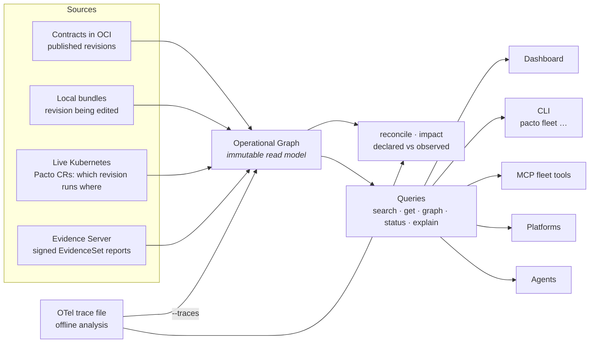
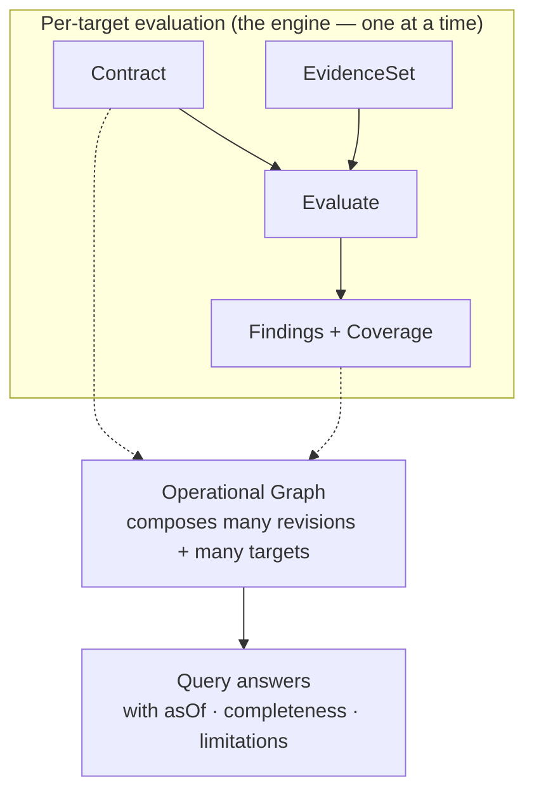

# The Pacto Operational Graph

The operational graph answers questions that span many services: *what depends
on payments-api, which revision runs in `production-eu`, is any of it failing its
contract and how sure are we?* It joins contracts, their published revisions and
the places they run into one view that people, CLIs, platforms and agents can
query.

```bash
pacto fleet search                                     # services found under .
pacto fleet graph payments-api --direction dependents  # who depends on it
pacto fleet status                                     # what needs attention
```

The graph only reads. It watches nothing and judges nothing: it collects
results other parts of Pacto produced.

## Three identities, never flattened

The graph models three distinct things and never collapses them into one: a name,
a revision and a running instance are different questions with different answers.

| Identity | What it is | Example |
|----------|-----------|---------|
| **Logical service** | A stable name and owner. It has revisions and runs in targets, but it is neither. | `payments-api` (owner: payments) |
| **Contract revision** | An immutable resolved revision. Identity is the service plus a content digest: the source's immutable digest, or one derived from the whole bundle when the source has none. Never a ref, never a version; a revision that can be neither pinned nor hashed is omitted rather than given a weaker identity. | `payments-api@sha256:…` |
| **Operational target** | A concrete place a revision runs, generic as `scope/kind/name`. | `production-eu/customer-a → kubernetes-workload payments/payments-api` |

### How certainly a target is matched to a revision

Knowing a target exists is not the same as knowing which revision it runs, so
every target records **how** the link was made.

| Match | What Pacto knows |
|-------|------------------|
| `exact` | The target's content digest matches a revision's. Authoritative: this is the revision running there. |
| `inferred` | A *unique* correlation by mutable tag or version suffix. Probably right, not proof. |
| `ambiguous` | Several revisions match that mutable reference. **No link is made** — a guess is never presented as fact — and the target carries a `REVISION_LINK_AMBIGUOUS` limitation. |
| `unresolved` | Nothing matched, or the target's identity contradicts itself. No link, and a limitation on the target saying so. |

The bottom two sit on the target itself, so a consumer can classify a link without
parsing snapshot-level messages. The two read surfaces spell it differently, and
the CLI's spelling has a trap:

- **Snapshot and `pacto fleet get --target` JSON** carry `revisionMatch`, which
  is `omitempty` and only ever `exact` or `inferred`. **An absent
  `revisionMatch` is the finding** — it means ambiguous or unresolved. Read the
  target's `limitations` to learn which.
- **The entity-detail API** (`GET /api/fleet/entities/target?key=…`, what the
  dashboard reads) carries `linkState`, always present, with all four values.

Its `inferred` is a different word from the `inferred` relationship provenance
below: one is how a *target* was matched to a revision, the other how an *edge*
was derived.

## Relationships: declared, observed, inferred

Edges carry a **provenance** discriminator so a fact's origin is never ambiguous:

- **declared** — from a contract (`dependencies[]`, and config/policy `ref`s).
- **observed** — seen in running traffic, kept in a separate adjacency index from
  the declared graph so the two can never leak into each other's answers.
- **inferred** — deduced heuristically. Reserved, not yet produced.
- **declared+observed** — one edge backed by both. The neighborhood projection
  merges the two indexes for display and emits this combined value, so a consumer
  branching on provenance must handle all four.

## Sources and queries

The graph is assembled from sources, each contributing what it can see right
now: contracts in your registry, local folders, live Kubernetes, the Evidence
Server and target-state files. It answers five kinds of question (search, get,
graph, status and explain). The
[operational graph reference](operational-graph-reference.md) lists every
source, the target-state file format, the query semantics and the canonical
owner key.

## Knowledge

Every Pacto answer carries how much of the world it actually saw. The words below
are not degrees of the same thing — they are different claims.

| Word | Claim |
|------|-------|
| **complete** | Every source answered. Nothing is missing. |
| **empty** | Every source answered and there is genuinely nothing. This is *complete* knowledge of an empty result. |
| **partial** | At least one source was unavailable, stale or itself partial. What you see is a floor, not a total. |
| **stale** | Every source answered, but one of them last saw the world a while ago. Its records are real and may have moved on since. |
| **unavailable** | A source did not answer at all. Whatever it knows is missing from this answer entirely. |
| **unknown** | We never received a completeness we could assert. Not the same as empty. |

Three of these travel on the wire, in every answer's `meta.completeness`:
`complete`, `partial` and `empty`. The other three are a consumer's reading of the
same envelope — `stale` and `unavailable` come from the per-source health reported
alongside it, and `unknown` is what is left when no envelope arrived at all. The
dashboard takes the worst of the six and gates every all-clear on that: a source
that is down must not be masked by the word the snapshot chose for itself.

**An unavailable source is never an empty result**, and a partial answer with
zero rows is not an empty result set — it is a set Pacto could not finish
building.

## Who consumes it

A human portal and an agent consume the *same* graph.



- **Dashboard** — the visual front door. It builds one snapshot from every source
  it detects and serves the graph and change analysis through `/api/fleet/*`.
  The endpoints the UI reads — overview, entities, neighborhood, attention —
  carry their own `schemaVersion`, `pacto.dev/fleet-product/v1`, so a UI
  versions independently of the `pacto.dev/fleet/v1` snapshot export above. The
  Operational Graph view offers three **perspectives** — Services, Revisions and
  Operational targets — and a **Knowledge** control (Expected · Observed ·
  Differences). It is honest about what it cannot know. An operational target
  links to the dependency *service* it depends on, never to each peer target,
  because a full target-to-target mesh would assert runtime routing the snapshot
  never observed.
- **CLI (`pacto fleet …`)** — the five queries on the command line, plus
  `reconcile` and `snapshot`. Scriptable, deterministic output.
- **MCP fleet tools** — `pacto_fleet_search`, `pacto_fleet_get`,
  `pacto_fleet_graph`, `pacto_fleet_status` and `pacto_fleet_explain`, plus
  [`pacto_impact`](impact.md), give an agent read-only understanding of the
  operational system. See [MCP integration](mcp-reference.md#three-tool-families-and-their-boundaries)
  for how they differ from authoring tools and generated service tools.

## A read model around many evaluations, not a new evaluator

Compliance is still the pure `Evaluate(Contract, EvidenceSet)` function producing
findings for one service in one environment (see [the Pacto
model](model.md#the-engine)). The graph is the read model *around* many such
evaluations — it references each target's findings and coverage rather than
re-computing them.



The graph also maintains a reverse-dependency index, which is what
[impact analysis](impact.md) traverses to answer "if this revision ships, which
consumers are affected, directly and transitively".

## Observed dependencies and reconciliation

Declared intent is half the picture; the other half is what traffic actually does.
The **OTel observer** (`pacto otel observe <traces.json>`) is an offline analyzer:
it reads an exported OTLP/JSON trace file and derives the caller-to-callee edges
its outbound spans prove. It never asserts a dependency is absent. It can also
emit signable EvidenceSets (`pacto otel observe --evidence`) so observed
dependencies travel the same [evidence protocol](evidence.md) as any
other report.

Those observed edges meet the declared graph in three places:

- **The snapshot itself** — `pacto fleet --traces <file>` and `pacto dashboard
  --traces` resolve each raw observed endpoint name to a **unique
  domain-qualified service** and fold resolved edges in as `observed`
  relationships. A name that matches zero or more than one service is **never**
  coerced to a domain; it is preserved as an `OBSERVED_IDENTITY_UNRESOLVED`
  limitation, so observed traffic can never be misattributed across domains.
- **Reconciliation** — `pacto fleet reconcile --traces <file>` labels each
  dependency **matched**, **declared-not-observed** (dormant or simply unseen in
  the window) or **observed-not-declared** (a *shadow* dependency the contract
  never mentions). Anything unresolvable is reported in a distinct **unresolved**
  category rather than force-fit to the default domain.
- **Impact** — `pacto impact --traces <file>` feeds the same observed edges into
  the affected-consumer list; the [confidence model](impact.md#confidence-model)
  has what they change there.

Reconciliation is an explicit backend fact, not a frontend guess: every declared
edge carries a state computed against the snapshot's observed edges. A snapshot
with no observation data returns `insufficient` and says so, rather than drawing
an empty Observed view that would read as "there is no traffic".

## Why the fleet is not a new contract kind

There is **no `kind: Fleet`** and **no `fleet:` section** in a contract. The graph
is *discovered* from the sources you already have. A fleet manifest would recreate
the problem Pacto exists to remove: a hand-maintained aggregate that drifts the
moment a service is added. The fleet is a *view*, computed on demand and versioned
by its as-of time.

## See also

- [Operational graph reference](operational-graph-reference.md) — sources,
  the target-state file, query semantics and owner keys
- [The Pacto model](model.md) — the engine, the compliance states and the
  boundaries the graph inherits
- [Impact analysis](impact.md) — the consumers a change affects, projected onto
  this graph
- [Fleet tools](fleet-tools.md) — the dashboard, `pacto fleet` and the terminal UI
- [MCP integration](mcp-integration.md) — the three MCP tool families
