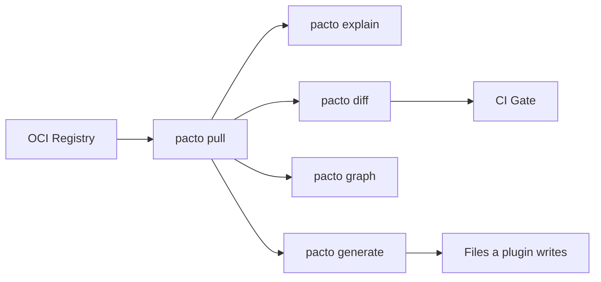

# Pacto for platform engineers

You run the platform other teams deploy to. [Pactify a service](pactify.md)
connects one service to delivery. This page is for the rest of the job:
reading any team's contract to see what its service needs to run, such as
its kind of workload, whether it keeps data, its APIs, the services it calls
and its settings.

How a service is deployed stays in its own Kubernetes files. With delivery,
`pacto publish` ships those files with each version and Flux applies them;
the contract only points at them (`publish.deploy`). The contract says what
the service is. Provisioning runs in your platform's tools; Pacto validates the
request and shows the result.

---

## Your workflow



### 1. Pull a service contract

```bash
pacto pull oci://ghcr.io/acme/contracts/payments-api:2.1.0
```

`explain`, `diff`, `graph` and `generate` accept `oci://` references directly and cache what they download, so this `pull` step is optional.

A private repository needs credentials first: `pacto login <registry>`, or an already-authenticated `gh` for GHCR. [Authentication](cli-reference.md#authentication) gives the full resolution order.

### 2. Inspect it

```bash
pacto explain oci://ghcr.io/acme/contracts/payments-api:2.1.0
```

See [`pacto explain`](cli-reference.md#pacto-explain) for the output format.

### 3. Check for breaking changes

```bash
pacto diff oci://ghcr.io/acme/contracts/payments-api:2.0.0 \
  oci://ghcr.io/acme/contracts/payments-api:2.1.0
```

It exits non-zero if breaking changes are detected. See [Diff and change classification](contract-reference/diff.md) for the full reference and worked examples.

### 4. Resolve the dependency graph

```bash
$ pacto graph oci://ghcr.io/acme/contracts/payments-api:2.1.0
payments-api@2.1.0
├─ auth-service@2.3.0
│  └─ user-store@1.0.0
└─ notifications@1.0.0 (shared)
```

Pacto follows each dependency to its own contract in the registry, all the way down, and caches the results. Add `--with-references` to also show configuration and policy references, or `--only-references` to show only those.

### 5. Generate deployment artifacts

If you would rather generate Kubernetes files from contracts than keep them
by hand, `pacto generate <name>` runs a plugin program called
`pacto-plugin-<name>` and writes the files it returns. The two official
plugins generate parts of an existing contract: `openapi-infer` writes the
OpenAPI document and `schema-infer` writes the configuration schema. Both need
a `pacto.yaml` in the folder first. To generate deployment files, write your own plugin: a small program in any language that reads a
contract as JSON and returns file contents. See
[Plugin development](plugins.md).

---

## Mapping contracts to infrastructure

### Workload type

| `workload` | Kubernetes resource | Notes |
|---|---|---|
| `service` | Deployment or StatefulSet | Based on `state.type` |
| `job` | Job | Runs to completion |
| `scheduled` | CronJob | Schedule defined externally |

### State model

The values below, such as `shared/persistent`, are short for the
`state.persistence.scope` and `state.persistence.durability` fields, as
`pacto explain` shows them. They describe the service. The table shows one
sensible way to map them on Kubernetes:

| `state.type` | `state.persistence` | Infrastructure |
|---|---|---|
| `stateless` | `local/ephemeral` | Deployment, no PVC, free to scale horizontally |
| `stateful` | `local/persistent` | StatefulSet + PVC, stable identity per replica |
| `stateful` | `local/ephemeral` | StatefulSet with emptyDir (stable identity, no durable storage) |
| `stateful` | `shared/persistent` | Network-attached or shared storage |
| `hybrid` | `local/persistent` | StatefulSet + PVC, tolerates cold starts |
| `hybrid` | `local/ephemeral` | Deployment with emptyDir, warm caches improve performance |

The contract leaves out upgrade strategy, shutdown timing, replica counts
and autoscaling on purpose. Those stay in your Kubernetes files.

---

## Offerings and infrastructure

Publish a contract for each kind of infrastructure you offer, with
`service.offering`, a provisioning schema in `configurations[]`, platform rules
in `policies[]` and a `service.lifecycle` when a version is on its way out.
Developers request a resource by referencing that contract from their own and
writing values your schema checks. Your adapter reads the published consumer
contract, provisions the resource and reports its state as signed evidence.
See [Provision infrastructure through contracts](provision-infrastructure.md).

---

## Add your own capability

Any platform team can offer its own capability, such as an image scanner, a
database service or an environment manager, as an ordinary provider contract.
The demo's `security-scanning` offering, provided by `platform-security`, is
the example:

1. Choose a `service.offering` slug. The slug is open: any lowercase name
   works, such as `security-scanning`.
2. Publish the provider contract with a configuration schema that consumers
   fill in. `platform-security` declares a `scan` configuration with `level`
   and `failOn`.
3. Write an adapter that reads each consumer contract, does the work and
   reports what it provisioned as `ResourceProvisioned` evidence with
   `pacto evidence provisioned`.
4. Give the adapter its own signing key and scope it to your provider
   repositories with `allowedProviderRepos`, so it can never mark another
   team's resource Ready. See
   [Trust store and trust config](evidence.md#trust-store-and-trust-config).

To govern the slugs your organization uses, publish a policy whose schema
restricts `service.offering` and reference it from every provider contract:

```json
{
  "$schema": "https://json-schema.org/draft/2020-12/schema",
  "type": "object",
  "properties": {
    "service": {
      "type": "object",
      "properties": {
        "offering": { "enum": ["postgresql", "security-scanning"] }
      }
    }
  }
}
```

```yaml
policies:
  - name: offerings
    ref: oci://ghcr.io/acme/platform-offerings-policy:1.0.0
```

### What Pacto shows for your capability

The offering page and `pacto fleet entity offering <slug>` list your
providers, their consumers and the [adapters](platform-offerings.md#adapters)
that reported on their requests. A request reads Unknown until a current
report arrives. A report from an unsigned target-state file reads
"Ready (unsigned)" and never counts as positive. `unresolvedUses` counts the
declared references that may name your provider but did not resolve.

Delivery appliers and operation types are built in. Extension capabilities
(`capabilities[].type: extension`) stay unverified, so report a scanner's
verdict as provisioning or runtime evidence. Pacto skips a generated MCP tool
of a provider bundle whose name starts with `pacto_`; see
[Bundle capabilities](mcp-reference.md#bundle-capabilities).

---

## Golden paths

Publish a golden path for each kind of service your teams start often: a
contract with `service.template`, the offerings it requires and the plugins it
offers to run, signed with `pacto publish`. Developers create services from it
with `pacto init --from`, and the fleet links each one back to its path. See
[Create a service from a golden path](golden-paths.md).

---

## See also

- [Configuration and policy](contract-reference/configuration-and-policy.md): the full reference
- [Composition patterns](patterns/index.md): root + component contracts,
  infrastructure contracts, published policy + schema bundles and the rest
- [Diff and change classification](contract-reference/diff.md): what counts as breaking
- [Put it in your repository](ci.md): using Pacto in pipelines
- [GitHub Actions integration](github-actions.md): the pacto-actions workflow
- [Fleet views](fleet-tools.md): all your services at once (dashboard, `pacto fleet`, terminal UI)
- [Kubernetes operator](integrations/kubernetes/overview.md): checks running
  services against their contracts, including
  [what they actually do on the network](integrations/kubernetes/runtime-conformance.md)
- [The operational graph](operational-graph.md): the fleet-wide read model
- [For developers](developers.md): the other side of the same contract
