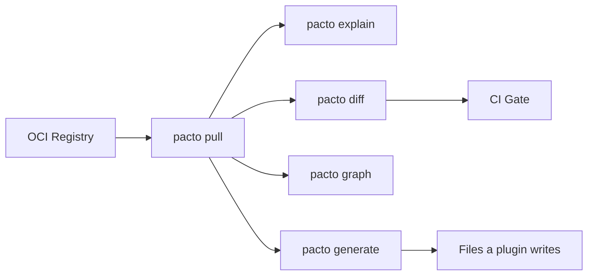

# Pacto for platform engineers

You run the platform other teams deploy to. [Pactify a service](pactify.md)
connects one service to delivery. This page is for the rest of the job:
reading any team's contract to see what its service needs to run, such as
its kind of workload, whether it keeps data, its APIs, the services it calls
and its settings.

How a service is deployed stays in its own Kubernetes files. With delivery,
`pacto publish` ships those files with each version and Flux applies them;
the contract only points at them (`publish.deploy`). The contract says what
the service is. Provisioning, scaling and wiring stay your decision.

---

## Your workflow



### 1. Pull a service contract

```bash
pacto pull oci://ghcr.io/acme/contracts/payments-api:2.1.0
```

`explain`, `diff`, `graph` and `generate` accept `oci://` references directly and cache what they download, so this `pull` step is optional.

A private repository needs credentials first: `pacto login <registry>`, or an already-authenticated `gh` for GHCR. [Authentication](cli-reference.md#authentication) gives the full resolution order.

### 2. Inspect it

```bash
pacto explain oci://ghcr.io/acme/contracts/payments-api:2.1.0
```

See [`pacto explain`](cli-reference.md#pacto-explain) for the output format.

### 3. Check for breaking changes

```bash
pacto diff oci://ghcr.io/acme/contracts/payments-api:2.0.0 \
  oci://ghcr.io/acme/contracts/payments-api:2.1.0
```

It exits non-zero if breaking changes are detected. See [Diff and change classification](contract-reference/diff.md) for the full reference and worked examples.

### 4. Resolve the dependency graph

```bash
$ pacto graph oci://ghcr.io/acme/contracts/payments-api:2.1.0
payments-api@2.1.0
├─ auth-service@2.3.0
│  └─ user-store@1.0.0
└─ notifications@1.0.0 (shared)
```

Pacto follows each dependency to its own contract in the registry, all the way down, and caches the results. Add `--with-references` to also show configuration and policy references, or `--only-references` to show only those.

### 5. Generate deployment artifacts

If you would rather generate Kubernetes files from contracts than keep them
by hand, `pacto generate <name>` runs a plugin program called
`pacto-plugin-<name>` and writes the files it returns. Pacto ships no plugin
that writes deployment files: the two official ones (`schema-infer` and
`openapi-infer`) work the other way, filling in a contract from files you
already have. A plugin is a small program in any language that reads a
contract as JSON and returns file contents. See
[Plugin development](plugins.md).

---

## Mapping contracts to infrastructure

### Workload type

| `workload` | Kubernetes resource | Notes |
|---|---|---|
| `service` | Deployment or StatefulSet | Based on `state.type` |
| `job` | Job | Runs to completion |
| `scheduled` | CronJob | Schedule defined externally |

### State model

The values below, such as `shared/persistent`, are short for the
`state.persistence.scope` and `state.persistence.durability` fields, as
`pacto explain` shows them. They describe the service, not a Kubernetes
setup; the table is one sensible way to map them on Kubernetes:

| `state.type` | `state.persistence` | Infrastructure |
|---|---|---|
| `stateless` | `local/ephemeral` | Deployment, no PVC, free to scale horizontally |
| `stateful` | `local/persistent` | StatefulSet + PVC, stable identity per replica |
| `stateful` | `local/ephemeral` | StatefulSet with emptyDir (stable identity, no durable storage) |
| `stateful` | `shared/persistent` | Network-attached or shared storage |
| `hybrid` | `local/persistent` | StatefulSet + PVC, tolerates cold starts |
| `hybrid` | `local/ephemeral` | Deployment with emptyDir, warm caches improve performance |

The contract leaves out upgrade strategy, shutdown timing, replica counts
and autoscaling on purpose. Those stay in your Kubernetes files.

---

## See also

- [Configuration and policy](contract-reference/configuration-and-policy.md) — the full reference
- [Composition patterns](patterns/index.md) — root + component contracts,
  infrastructure contracts, published policy + schema bundles and the rest
- [Diff and change classification](contract-reference/diff.md) — what counts as breaking
- [CI integration](ci.md) — using Pacto in pipelines
- [GitHub Actions integration](github-actions.md) — the pacto-actions workflow
- [Fleet views](fleet-tools.md) — all your services at once (dashboard, `pacto fleet`, terminal UI)
- [Kubernetes operator](integrations/kubernetes/overview.md) — checks running
  services against their contracts, including
  [what they actually do on the network](integrations/kubernetes/runtime-conformance.md)
- [The operational graph](operational-graph.md) — the fleet-wide read model
- [For developers](developers.md) — the other side of the same contract
