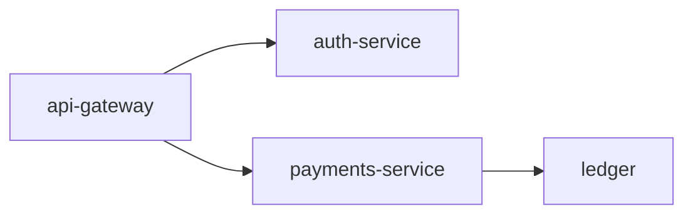

# Payments Service v2.1.2

Declares the payments business domain (pactoVersion 2.4).

## Changes from v2.1.1
- Added `service.domain: payments`

## Request flow

The gateway authenticates, then payments settles and records to the ledger:

