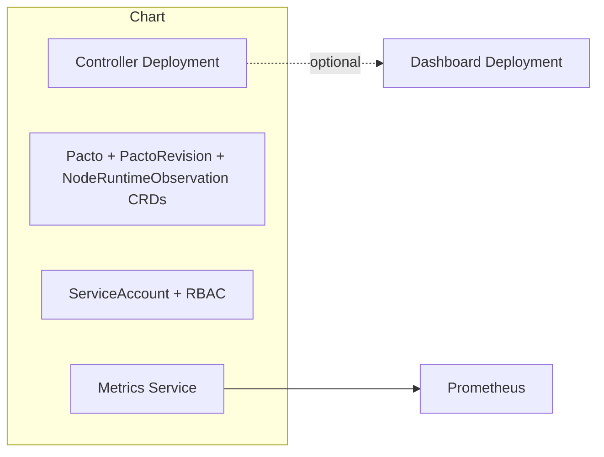

# pacto-operator

    [](https://artifacthub.io/packages/search?repo=pacto-operator)

Kubernetes operator for Pacto service contract validation

## Documentation

- [CRD Reference](https://pacto.run/latest/integrations/kubernetes/crd-reference/) — autogenerated CRD API reference for `Pacto`, `PactoRevision` and `NodeRuntimeObservation` resources
- [Helm Values](#values) — autogenerated values table (below)

## Index

- [Overview](#overview)
- [Architecture](#architecture)
- [Installation](#installation)
- [Upgrade and Compatibility](#upgrade-and-compatibility)
- [CRDs](#crds)
- [Dashboard](#dashboard)
- [Metrics and Observability](#metrics-and-observability)
- [Security](#security)
- [Values](#values)
- [Artifact Verification](#artifact-verification)
- [Maintainers](#maintainers)

## Overview

This chart deploys the [Pacto Operator](https://github.com/TrianaLab/pacto/tree/main/integrations/kubernetes). It tells you, for each service in your cluster, whether what is running still matches its [Pacto](https://github.com/TrianaLab/pacto) contract. With the optional node agent (`nodeAgent.enabled=true`), it also checks what each service actually does on the network against its contract, and reports only what it can prove. See [Runtime conformance](https://pacto.run/latest/integrations/kubernetes/runtime-conformance/).

What the chart installs:

- Controller `Deployment` with health and readiness probes
- RBAC: a `ServiceAccount`, a cluster-scoped `ClusterRole` + `ClusterRoleBinding` (reads, and the dashboard's ClusterRole), a manager `Role` + `RoleBinding` in the release namespace (the dashboard and Evidence Server lifecycle) and a namespaced leader-election `Role` + `RoleBinding`
- Metrics `Service` on port 8443 (HTTPS by default with the chart's `metrics.secure=true`; see [Metrics and Observability](#metrics-and-observability))
- CRDs: `Pacto`, `PactoRevision` and `NodeRuntimeObservation` (from the `crds/` directory)
- Optional: Prometheus `ServiceMonitor`
- Optional: the node agent `DaemonSet` (`nodeAgent.enabled`, off by default), in its own namespace (`nodeAgent.namespace`, default `pacto-node-agent`) that the chart creates privileged for Pod Security, with a `ValidatingAdmissionPolicy` binding each agent's writes to its own node

The operator never modifies your workloads. It only reads them and reports whether they match their contracts.

## Architecture



The chart installs the controller and its supporting resources. The dashboard and Prometheus integration are optional features controlled by values.

## Installation

```bash
helm install pacto-operator oci://ghcr.io/trianalab/pacto/charts/pacto-operator \
  --namespace pacto-operator-system --create-namespace
```

Pin to a specific version:

```bash
helm install pacto-operator oci://ghcr.io/trianalab/pacto/charts/pacto-operator \
  --version 6.0.1 \
  --namespace pacto-operator-system --create-namespace
```

## Upgrade and Compatibility

- The chart version tracks the operator version. A chart upgrade includes the corresponding controller update.
- CRDs are managed via the `crds/` directory. Helm installs CRDs before other resources but does **not** upgrade or delete them automatically. To update CRDs, apply them manually: `kubectl apply --server-side --force-conflicts -f charts/pacto-operator/crds/`.
- See the [release notes](https://github.com/TrianaLab/pacto/releases) for breaking changes between versions.

## CRDs

CRDs are installed automatically from the `crds/` directory on first install. Helm does not delete CRDs on `helm uninstall` (by design) to prevent accidental data loss.

### OCI Contract References

The `spec.contractRef.oci` field supports three forms that control version resolution:

| Form | Example | Behavior |
|------|---------|----------|
| Unversioned | `ghcr.io/org/my-service` | Tracks the latest semver tag. Re-resolved on every reconciliation. |
| Tagged | `ghcr.io/org/my-service:1.2.3` | Pinned to that exact tag. No automatic version updates. |
| Digest | `ghcr.io/org/my-service@sha256:abc...` | Immutable. Always resolves to this exact content. |

```yaml
# Track latest — operator auto-resolves highest semver tag
spec:
  contractRef:
    oci: ghcr.io/my-org/contracts/my-service

# Pin to v1.2.3 — stable, no drift
spec:
  contractRef:
    oci: ghcr.io/my-org/contracts/my-service:1.2.3

# Immutable digest — reproducible builds
spec:
  contractRef:
    oci: ghcr.io/my-org/contracts/my-service@sha256:abcdef...
```

#### Resolved mode

The resolved mode is **auto-detected from the shape of the reference** and reported in `status.resolutionPolicy`:

- **No tag and no digest** → `Latest`. The operator resolves the highest semver tag and **re-resolves on every reconciliation**, so the pinned content can drift as new tags are published.
- **An exact tag** (`:1.2.3`) → `PinnedTag`. Used as-is, no automatic updates.
- **An `@sha256:` digest** → `PinnedDigest`. Immutable, always the same content.

#### Registry credentials

The operator pulls contracts using the credential paths described under [Private OCI Registries](#private-oci-registries). The dashboard reads its credentials from the `dashboard.ociSecrets` list. Opaque secrets used for dashboard credentials **must** include a `registry` key naming the target hostname, because go-containerregistry performs exact hostname matching.

## Dashboard

The dashboard is **enabled by default**. The operator manages the dashboard Deployment, internal Service (`pacto-dashboard`, ClusterIP), ServiceAccount, and RBAC.

The dashboard image is **injected into the controller binary at build time via ldflags** (a `dashboardImage` variable in the `cmd` package), which couples the dashboard version to the Pacto library the controller was built against. It is **not** overridable through Helm values or any runtime flag. If the dashboard is enabled but the binary was built without this ldflag (so `dashboardImage` is empty), the controller fails to start — the dashboard cannot be deployed from a binary that lacks an embedded image reference.

The chart creates a separate exposure Service (`pacto-operator-dashboard` for the documented `pacto-operator` release; the name is `<fullname>-dashboard`) with configurable type, plus optional Ingress and HTTPRoute resources. The operator owns the lifecycle; the chart owns the networking. These are distinct concerns:

| Resource | Managed by | Purpose |
|----------|-----------|---------|
| `pacto-dashboard` Service | Operator | Internal ClusterIP on port 3000, always present when dashboard is enabled |
| `pacto-operator-dashboard` Service (`<fullname>-dashboard`) | Chart | Configurable type (ClusterIP/NodePort/LoadBalancer) on port 3000 (`dashboard.service.port`), backend for Ingress/HTTPRoute |
| Ingress | Chart | Optional, references the chart-managed Service |
| HTTPRoute | Chart | Optional, references the chart-managed Service. When `rules` is empty, a catch-all rule routes all traffic to the dashboard |

In total a chart install can stand up **three** Services: the metrics Service on port 8443 (see [Metrics and Observability](#metrics-and-observability)), the operator-managed internal `pacto-dashboard` ClusterIP on port 3000, and the chart-managed dashboard exposure Service on port 3000 (whose type is configurable via `dashboard.service.type`).

### Private OCI Registries

There are two independent credential paths for private registries:

| Credential | Used by | Configured via |
|------------|---------|----------------|
| `spec.contractRef.pullSecretRef` | **Operator** (pulling contracts during reconciliation) | Per-Pacto CR field |
| `dashboard.ociSecrets` | **Dashboard** pod (browsing contracts in the UI) | Helm value |

All three secret formats are supported in both paths:

- **Opaque** with `registry` + `token` keys — bearer/registry token (e.g. a GitHub PAT)
- **Opaque** with `registry` + `username` + `password` keys — basic auth
- **`kubernetes.io/dockerconfigjson`** — standard Docker registry auth (supports multiple registries per secret)

> **Note:** For dashboard credentials, Opaque secrets **must** include a `registry` key specifying the target hostname (e.g. `ghcr.io`). This is required because go-containerregistry performs exact hostname matching. For operator credentials (per-Pacto CR), the `registry` key is not needed — the operator infers it from the OCI reference.

#### Operator credentials (per Pacto CR)

Create a Secret in the **same namespace** as the Pacto CR:

```bash
# Option 1: Opaque with username + password
kubectl create secret generic ghcr-creds \
  --from-literal=username=x-access-token \
  --from-literal=password="$(gh auth token)" \
  -n my-namespace

# Option 2: dockerconfigjson (standard Docker auth)
kubectl create secret docker-registry ghcr-creds \
  --docker-server=ghcr.io \
  --docker-username=x-access-token \
  --docker-password="$(gh auth token)" \
  -n my-namespace
```

Then reference it in the Pacto CR:

```yaml
apiVersion: pacto.trianalab.io/v1alpha1
kind: Pacto
metadata:
  name: my-service
  namespace: my-namespace
spec:
  contractRef:
    oci: ghcr.io/my-org/contracts/my-service
    pullSecretRef: ghcr-creds
```

The operator watches the Secret — credential rotation triggers re-reconciliation automatically. For `dockerconfigjson` secrets, the operator matches the registry hostname from the OCI reference against the auths in the secret.

#### Dashboard credentials (Helm value)

To give the dashboard pod access to private registries, create Secrets in the **operator namespace** and configure them via Helm values. The operator reads these source secrets, merges their credentials, and creates a managed `dockerconfigjson` secret that the dashboard pod mounts automatically.

```yaml
dashboard:
  ociSecrets:
    - ghcr-creds
    - ecr-creds
```

Credentials from all secrets are merged; later secrets override earlier ones for the same registry.

```bash
# Option 1: dockerconfigjson (recommended for multi-registry)
kubectl create secret docker-registry ghcr-creds \
  --docker-server=ghcr.io \
  --docker-username=x-access-token \
  --docker-password="$(gh auth token)" \
  -n pacto-operator-system

# Option 2: Opaque with registry key
kubectl create secret generic ghcr-creds \
  --from-literal=registry=ghcr.io \
  --from-literal=username=x-access-token \
  --from-literal=password="$(gh auth token)" \
  -n pacto-operator-system
```

To disable the dashboard:

```yaml
dashboard:
  enabled: false
```

### Accessing the dashboard

**Port-forward** (default, no extra config):

```bash
kubectl port-forward svc/pacto-operator-dashboard 3000:3000 -n pacto-operator-system
```

**NodePort**:

```yaml
dashboard:
  service:
    type: NodePort
    nodePort: 30300
```

**LoadBalancer**:

```yaml
dashboard:
  service:
    type: LoadBalancer
```

**Ingress**:

```yaml
dashboard:
  ingress:
    enabled: true
    className: nginx
    hosts:
      - host: pacto.example.com
        paths:
          - path: /
            pathType: Prefix
    tls:
      - secretName: pacto-tls
        hosts:
          - pacto.example.com
```

**HTTPRoute (Gateway API)**:

```yaml
dashboard:
  httpRoute:
    enabled: true
    parentRefs:
      - name: main-gateway
        namespace: gateway-system
    hostnames:
      - pacto.example.com
```

The dashboard is always deployed into the release namespace. Its observation scope is inherited from `controller.watchNamespace` — there is no separate dashboard scope configuration.

### Observation Scope

By default, the controller watches **all namespaces**. To restrict it to a single namespace:

```yaml
controller:
  watchNamespace: production
```

The dashboard inherits this scope automatically.

## Metrics and Observability

The controller exposes Prometheus metrics via OpenTelemetry on port 8443.

> **HTTPS default depends on how you run it.** The chart sets `metrics.secure=true` by default, so a Helm install serves metrics over HTTPS. The controller binary, however, defaults to `--metrics-secure=false` — a direct binary run serves plain HTTP unless you pass `--metrics-secure=true`. Authentication and authorization (the metrics auth FilterProvider) are enabled **only** when secure mode is on; in plain-HTTP mode the endpoint is unauthenticated.

| Metric | Type | Description |
|--------|------|-------------|
| `pacto_contract_status` | Gauge | Info-style gauge (labels: name, namespace, status). 1 for the current status, 0 for all others |
| `pacto_contract_compliance_status` | Gauge | 1 = compliant, 0 = non-compliant |
| `pacto_contract_validation_errors` | Gauge | Count of error-severity failures |
| `pacto_contract_validation_warnings` | Gauge | Count of warning-severity mismatches |
| `pacto_contract_validation_result` | Gauge | Per-check result (1=pass, 0=fail) |

Enable a Prometheus ServiceMonitor:

```yaml
metrics:
  serviceMonitor:
    enabled: true
```

Pre-built PrometheusRule alerting templates are available in `config/prometheus/alerts.yaml`. Apply them manually:

```bash
kubectl apply -f config/prometheus/alerts.yaml
```

## Security

The chart follows security best practices by default:

- Runs as non-root (UID 65532, distroless base image)
- Read-only root filesystem
- All capabilities dropped
- Seccomp profile set to `RuntimeDefault`
- Metrics endpoint served over HTTPS with authentication (chart default `metrics.secure=true`; the binary default is `--metrics-secure=false`)

## Artifact Verification

The Helm chart and controller image are signed with [Cosign](https://docs.sigstore.dev/cosign/signing/overview/) using keyless (OIDC) signing.

```bash
cosign verify \
  --certificate-oidc-issuer https://token.actions.githubusercontent.com \
  --certificate-identity-regexp 'github.com/TrianaLab/pacto/.github/workflows/release.yml' \
  ghcr.io/trianalab/pacto/charts/pacto-operator:<version>
```

## Values

| Key | Type | Default | Description |
|-----|------|---------|-------------|
| affinity | object | `{}` | Affinity rules for the controller pod |
| controller.enableMetricsObservation | bool | `false` | Observe the metrics capability (ServiceMonitor, PodMonitor, annotation or named-port discovery plus an active scrape). Also grants read access to ServiceMonitors and PodMonitors. Off by default; when off, metrics read unsupported. |
| controller.enableProbing | bool | `false` | Actively probe in-cluster endpoints: the health capability over HTTP and the wire protocol of each present interface. Off by default; when off, health uses passive readiness-probe and EndpointSlice signals only and interface protocols read unverified. |
| controller.kernelEvidence.enabled | bool | `false` | Merge the node agent's kernel observations (NodeRuntimeObservation objects) into interface and dependency evidence. Needs the node agent running; off by default, so evidence comes from the Kubernetes API only. Kernel evidence is on whenever this OR nodeAgent.enabled is true: a managed agent whose observations nobody merges would be pure cost. Set this alone only for an agent you run yourself. |
| controller.kernelEvidence.namespace | string | `""` | Namespace the node agent publishes to. Empty uses nodeAgent.namespace. |
| controller.kernelEvidence.staleness | string | `""` | How old a node's heartbeat may be before its evidence reads stale. Empty uses three times the node agent's publish interval. Accepts a Go duration (e.g. "2m"). |
| controller.stabilizationWindow | string | `""` | Stabilization window: how long a sustained NEGATIVE observation must persist before it converts to a confirmed violation (a transient blip reads Unknown meanwhile). Empty string uses the controller default (2m). Accepts a Go duration (e.g. "30s", "5m"). |
| controller.watchNamespace | string | `""` | Restrict the controller's observation scope to a single namespace. Empty string (default) means cluster-wide: the controller watches all namespaces. The dashboard inherits this scope automatically. |
| dashboard.auth.deliveryNamespace | string | `""` | Namespace where Pacto delivery runs. The dashboard reads the identity policy it publishes there (agent, break-glass and human groups, team prefix), so it is never configured twice (empty: `delivery.namespace` when `delivery.enabled`, else `pacto-delivery`) |
| dashboard.auth.oidc.clientID | string | `""` | The dashboard's client id at the issuer |
| dashboard.auth.oidc.clientSecretRef.key | string | `"client-secret"` | Key of the client secret in that Secret |
| dashboard.auth.oidc.clientSecretRef.name | string | `""` | Secret in the operator namespace holding the client secret (passed by secretKeyRef) |
| dashboard.auth.oidc.extraScopes | list | `[]` | Scopes asked for beyond openid, profile and groups (for example a cross-client audience scope) |
| dashboard.auth.oidc.issuerURL | string | `""` | OpenID Connect issuer URL people sign in with (empty: no sign-in) |
| dashboard.auth.oidc.redirectURL | string | `""` | The dashboard's `/auth/callback` URL as browsers reach it |
| dashboard.auth.required | bool | `false` | Gate the fleet views and the whole API behind sign-in too, not only delivery (needs `oidc.issuerURL`) |
| dashboard.enabled | bool | `true` | Enable the operator-managed dashboard deployment. The dashboard image is controlled by the operator and derived from the bundled Pacto library version. It is not user-configurable. |
| dashboard.httpRoute.enabled | bool | `false` | Enable Gateway API HTTPRoute for the dashboard |
| dashboard.httpRoute.hostnames | list | `[]` | Hostnames for the HTTPRoute |
| dashboard.httpRoute.parentRefs | list | `[]` | Parent gateway references |
| dashboard.httpRoute.rules | list | `[]` | HTTPRoute rules. When empty, a single catch-all rule is generated that routes all traffic to the chart-managed dashboard Service on dashboard.service.port. |
| dashboard.ingress.annotations | object | `{}` | Ingress annotations |
| dashboard.ingress.className | string | `""` | Ingress class name |
| dashboard.ingress.enabled | bool | `false` | Enable Ingress for the dashboard |
| dashboard.ingress.hosts | list | `[{"host":"pacto-dashboard.local","paths":[{"path":"/","pathType":"Prefix"}]}]` | Ingress hosts |
| dashboard.ingress.tls | list | `[]` | Ingress TLS configuration |
| dashboard.miraURL | string | `""` | Mira's address, to link the health-check citations in delivery views |
| dashboard.observation.sources | list | `[]` | Offline OTLP/JSON trace exports to mount read-only into the dashboard, so its Operational Graph can reconcile declared dependencies against observed ones. Each entry is one named data source: `name` is its stable Data Source identity (a DNS-1123 label) — reordering this list never renames a source, and it must not collide with any other data source the dashboard has (the live cluster, OCI, the disk cache, local bundles, an Evidence Server); `file` is the trace file's name directly inside that source's mount — a single path segment, so mount a claim whose export sits at the top of its own directory; and exactly one of `existingClaim` (an existing PVC, for real exports) or `configMap` (small static exports only, ~1 MiB cap) supplies it. Pacto reads exactly the declared files — through a root it cannot follow a symlink out of — never writes to them and never scans the mount. Whoever owns that storage owns producing and rotating the exports. This configures OFFLINE input only: Pacto ships no OTLP receiver and no trace collector (the optional node agent is an eBPF socket observer, not a trace pipeline). |
| dashboard.ociSecrets | list | `[]` | List of Secret names for OCI registry credentials. Supports Opaque (keys: registry + token, or registry + username + password) and kubernetes.io/dockerconfigjson secrets. When set, credentials from all secrets are merged; later secrets override earlier ones for the same registry. |
| dashboard.resources.limits.memory | string | `"512Mi"` | Memory limit for the dashboard container. The earlier default of 128Mi was OOMKilled while monitoring several OCI repositories and CRs at once; raise it further if the dashboard tracks a large fleet. |
| dashboard.resources.requests.cpu | string | `"50m"` | CPU request for the dashboard container |
| dashboard.resources.requests.memory | string | `"128Mi"` | Memory request for the dashboard container |
| dashboard.service.nodePort | string | `""` | Node port (only used when type is NodePort) |
| dashboard.service.port | int | `3000` | Dashboard service port |
| dashboard.service.type | string | `"ClusterIP"` | Dashboard exposure Service type (ClusterIP, NodePort, LoadBalancer). The operator manages an internal ClusterIP Service (pacto-dashboard) for pod-to-pod communication. This chart-managed Service provides configurable external access and serves as the backend for Ingress/HTTPRoute resources. Selects dashboard pods via operator-defined labels. |
| delivery.admissionPolicies.allowUnguarded | bool | `false` | Render without the policies (enabled=false) anyway, and skip the chart's Kubernetes 1.30 and ValidatingAdmissionPolicy API check. Without the policies anyone who may create an Operation or an Approval can claim to be anyone, so the chart refuses either unless this is set. |
| delivery.admissionPolicies.enabled | bool | `true` | Install the ValidatingAdmissionPolicies (Kubernetes 1.30 or later): an operation's actor is the requesting user, only the promoter may set witnessed, override and unfreeze are limited to their raisers, cancel is refused once the pointer moved and an agent cancels only its own operations, approvals come from people and never change, spec.ref.digest is edited only by the promoter or break-glass, and on objects labelled delivery.pacto.trianalab.io/apply-ref the label, the source and what a Kustomization applies change only by break-glass. The promoter admits no operation and counts no approval while any of them is missing or does not deny. |
| delivery.affinity | object | `{}` | Affinity for the promoter pod |
| delivery.argocd.enabled | bool | `false` | Let Stages name an Argo CD Application as their applier (`spec.applyRef.kind: Application`). Grants the promoter patch on `argoproj.io` Applications (it only sets `spec.source.targetRevision`, and the pointer admission policy holds it to that) and read access to the agent, approver and recorder roles. Off by default. |
| delivery.createNamespace | bool | `true` | Create `delivery.namespace`. Set false to create it yourself first, for example to put the recorder key Secret in it before the install |
| delivery.enabled | bool | `false` | Install Pacto delivery: the promoter, its CRDs (Stage, Operation, Approval), roles and admission policies |
| delivery.gates.providers | list | `[]` | Health gate providers a Stage may name in `spec.gates.verify.checks[].provider`, each `{name, type, url}` with type `mira` (Mira's query API), `http` (any tool behind the plug-in format) or `eval` (an eval runner for an AI agent's eval suite). The URL is operator configuration: a Stage only names a provider and an agent names nothing. `pacto.contract` and `pacto.runtime` are built in. |
| delivery.identities.agentGroups | list | `["pacto:agents"]` | Groups whose members are agents. Agents may propose, never approve or unfreeze. Service accounts other than the promoter are always agents. |
| delivery.identities.breakGlassGroups | list | `["pacto:break-glass"]` | Groups that may raise an override and edit an OCIRepository's spec.ref.digest directly |
| delivery.identities.humanGroups | list | `[]` | When set, only members of these groups count as people. Anyone in none of them is an agent, so an agent identity nobody enrolled in an agent group still cannot approve. Empty classifies by `agentGroups` alone. |
| delivery.identities.requireOwnerTeam | bool | `true` | A held question whose service and consumers declare no owner team is answered by nobody, and only break-glass can override. Set false to let any person answer it, as before. |
| delivery.identities.teamGroupPrefix | string | `""` | Only members of the teams a held question names may answer it. A contract owner team `T` is the identity-provider group `T`, or once this prefix is set only this prefix followed by `T` (for example `acme:`). A `system:` group is never a team. |
| delivery.image.digest | string | `""` | Pins the image by digest (sha256:...), appended to the tag as tag@digest so the runtime pulls exactly that image whatever the tag resolves to later |
| delivery.image.pullPolicy | string | `"IfNotPresent"` | Image pull policy |
| delivery.image.repository | string | `"ghcr.io/trianalab/pacto/delivery"` | Promoter image repository (the pacto-delivery image) |
| delivery.image.tag | string | `""` | Overrides the image tag (default is the chart appVersion) |
| delivery.imagePullSecrets | list | `[]` | Image pull secrets for private registries |
| delivery.insecureRegistries | list | `[]` | Registry hosts (`host:port`) the promoter and the recorder reach over plain HTTP. An OCIRepository with `spec.insecure: true` is read over HTTP anyway. |
| delivery.metrics.enabled | bool | `true` | Expose the promoter's and the recorder's metrics (plain HTTP, port 8080) through a Service |
| delivery.metrics.serviceMonitor.enabled | bool | `false` | Create a Prometheus Operator ServiceMonitor for that Service |
| delivery.metrics.serviceMonitor.interval | string | `""` | Scrape interval (empty uses Prometheus' default) |
| delivery.metrics.serviceMonitor.scrapeTimeout | string | `""` | Scrape timeout (empty uses Prometheus' default) |
| delivery.namespace | string | `"pacto-delivery"` | Dedicated namespace the promoter and the recorder run in. The chart creates it; it must not be the release namespace (the operator can create Deployments and Secrets there). |
| delivery.nodeSelector | object | `{}` | Node selector for the promoter pod |
| delivery.podSecurityContext.runAsNonRoot | bool | `true` | Run pod as non-root |
| delivery.podSecurityContext.seccompProfile.type | string | `"RuntimeDefault"` | Seccomp profile type |
| delivery.promoter.authFreshness | string | `"15m"` | How old a person's login may be when their approval is given; an older one is ignored (a Go duration). Every Stage publishes it in `status.authFreshness` |
| delivery.promoter.leaderElect | bool | `true` | Elect one active promoter |
| delivery.promoter.poll | string | `"3s"` | How often an operation waiting on Flux, Pacto or a person is looked at (a Go duration) |
| delivery.promoter.registryCredentials.secretName | string | `""` | A `kubernetes.io/dockerconfigjson` Secret with read access to the contract and deploy repositories, for a private registry. Without it the promoter reads only public ones. |
| delivery.promoter.upstreamTrust | string | `""` | The recorder keys of other clusters, as a trust config in YAML (keys per stream glob). A Stage with `candidates.upstreamRecords` promotes only on records one of these keys signed for that stream; without it such a Stage is not Ready. Public keys only. |
| delivery.promoter.workers | int | `4` | How many operations and Stages the promoter reconciles at once, so one slow health provider does not hold up the rest |
| delivery.recorder.cdeventsSink | string | `""` | A URL the recorder POSTs a CDEvent (CloudEvents, structured mode) to for every record, best effort. Empty sends none. |
| delivery.recorder.enabled | bool | `false` | Run the recorder, which writes a signed record of every concluded operation to the registry as OCI referrers. Off by default. When on, the promoter leaves the record finalizer to it. The registry must support the OCI Referrers API natively (GHCR and released `distribution` do not). |
| delivery.recorder.extraEnv | list | `[]` | Extra environment for the recorder (for example the credentials a KMS client reads) |
| delivery.recorder.leaderElect | bool | `true` | Elect one active recorder |
| delivery.recorder.monitoring.enabled | bool | `false` | Scrape the recorder's metrics and alert when records fall behind: a metrics Service, a ServiceMonitor and a PrometheusRule. Needs the Prometheus Operator CRDs. |
| delivery.recorder.operationTTL | string | `"168h"` | Keep a recorded operation this long after it concluded, then delete it: its record holds what happened. The operation a Stage runs is never deleted. `0s` keeps them all (a Go duration). |
| delivery.recorder.poll | string | `"30s"` | How long a registry or signer failure backs off (a Go duration) |
| delivery.recorder.registryCredentials.secretName | string | `""` | A `kubernetes.io/dockerconfigjson` Secret with push access to the streams, apply and contract repositories. Only the recorder mounts it. |
| delivery.recorder.resources.limits.cpu | string | `"500m"` | CPU limit |
| delivery.recorder.resources.limits.memory | string | `"256Mi"` | Memory limit |
| delivery.recorder.resources.requests.cpu | string | `"10m"` | CPU request |
| delivery.recorder.resources.requests.memory | string | `"64Mi"` | Memory request |
| delivery.recorder.serviceAccount.annotations | object | `{}` | Annotations to add to the recorder's ServiceAccount (workload identity for KMS or keyless) |
| delivery.recorder.serviceAccount.create | bool | `true` | Create a ServiceAccount for the recorder |
| delivery.recorder.serviceAccount.name | string | `""` | Name override (defaults to `<fullname>-delivery-recorder`) |
| delivery.recorder.signing.ed25519.key | string | `"key.pem"` | The key in that Secret |
| delivery.recorder.signing.ed25519.secretName | string | `""` | A Secret holding a PKCS#8 PEM Ed25519 private key (for kind and tests) |
| delivery.recorder.signing.keyless.enabled | bool | `false` | Sign keyless with a Fulcio certificate for the recorder's workload identity, presented as a projected service account token for the `sigstore` audience. Rekor upload is off; a timestamp authority dates each signature. |
| delivery.recorder.signing.keyless.fulcioURL | string | `""` | The Fulcio that issues the certificate |
| delivery.recorder.signing.keyless.identity | string | `""` | The certificate identity keyless signing produces |
| delivery.recorder.signing.keyless.issuer | string | `""` | The OIDC issuer keyless signing uses |
| delivery.recorder.signing.keyless.timestampURL | string | `""` | The timestamp authority whose signed time a short-lived certificate verifies at |
| delivery.recorder.signing.keyless.trustedRoot | string | `""` | The Sigstore trusted root (`trusted_root.json`) naming that Fulcio and timestamp authority. Required with keyless: without it a self-signed certificate could name the recorder's identity. |
| delivery.recorder.signing.kms | string | `""` | A KMS key URI (`awskms://`, `gcpkms://`, `azurekms://`, `hashivault://`). The default image includes every provider; an image built with `--build-arg GO_TAGS=` has none, and one built with `GO_TAGS=kms_aws` (or `kms_gcp`, `kms_azure`, `kms_hashivault`) has only that one |
| delivery.recorder.streamsRepository | string | `""` | Repository (`host/path`) that holds one anchor per Stage stream. Required when enabled. |
| delivery.recorder.trust | string | `""` | Other keys whose records the recorder accepts, as a trust config in YAML (`keys: [{publicKey: <PEM>, streams: ["*/prod/*"]}]`): list the old key here while you rotate to a new one, and set `untilSeq` and `untilRecord` on a leaked key to revoke it after the last record it signed. The recorder's own key is always trusted. A record no listed key signed is skipped as untrusted. |
| delivery.replicaCount | int | `1` | Number of promoter replicas. Only the elected leader acts. |
| delivery.resources.limits.cpu | string | `"500m"` | CPU limit |
| delivery.resources.limits.memory | string | `"256Mi"` | Memory limit |
| delivery.resources.requests.cpu | string | `"10m"` | CPU request |
| delivery.resources.requests.memory | string | `"64Mi"` | Memory request |
| delivery.securityContext.allowPrivilegeEscalation | bool | `false` | Disallow privilege escalation |
| delivery.securityContext.capabilities.drop | list | `["ALL"]` | Drop all capabilities |
| delivery.securityContext.readOnlyRootFilesystem | bool | `true` | Read-only root filesystem |
| delivery.securityContext.runAsNonRoot | bool | `true` | Run as non-root |
| delivery.securityContext.runAsUser | int | `65532` | Run as UID 65532 (nonroot in distroless) |
| delivery.serviceAccount.annotations | object | `{}` | Annotations to add to the ServiceAccount |
| delivery.serviceAccount.create | bool | `true` | Create a ServiceAccount for the promoter |
| delivery.serviceAccount.name | string | `""` | Name override (defaults to `<fullname>-delivery`) |
| delivery.tolerations | list | `[]` | Tolerations for the promoter pod |
| evidence.enabled | bool | `false` | Enable the operator-managed Evidence Server deployment. Disabled by default. When enabled the operator reconciles a SEPARATE Evidence Server Deployment and an internal Service; the image is the same runtime image as the dashboard and is not user-configurable. The Evidence Server is single- writer, so its replica count is fixed at one. |
| evidence.httpRoute.enabled | bool | `false` | Enable Gateway API HTTPRoute for the Evidence Server. |
| evidence.httpRoute.hostnames | list | `[]` | Hostnames for the HTTPRoute. |
| evidence.httpRoute.parentRefs | list | `[]` | Parent gateway references. |
| evidence.httpRoute.rules | list | `[]` | HTTPRoute rules. When empty, a single catch-all rule routes to the chart-managed evidence Service on evidence.service.port. |
| evidence.ingress.annotations | object | `{}` | Ingress annotations. |
| evidence.ingress.className | string | `""` | Ingress class name. |
| evidence.ingress.enabled | bool | `false` | Enable Ingress for the Evidence Server. |
| evidence.ingress.hosts | list | `[{"host":"pacto-evidence.local","paths":[{"path":"/","pathType":"Prefix"}]}]` | Ingress hosts. |
| evidence.ingress.tls | list | `[]` | Ingress TLS configuration. |
| evidence.registry.credentialsSecret | string | `""` | Optional name of an EXISTING kubernetes.io/dockerconfigjson Secret with credentials for that registry, mounted read-only. The chart never creates it and never renders its contents. Empty means anonymous or in-cluster access. |
| evidence.registry.subjects | list | `[]` | Required when evidence is enabled: the exact, immutable contract revisions evidence may be reported against, each an oci://<repo>@sha256:<digest> reference. The registry holding them IS the durable evidence store — every accepted record is published as an OCI 1.1 referrer of one of these manifests — so the chart installs nothing durable in the cluster. A mutable tag is rejected: it could be moved onto another manifest and silently change what the stored evidence reports on. That registry must serve the native OCI 1.1 Referrers API — GHCR and CNCF distribution (registry:2, registry:3) do not, and the Evidence Server stays permanently not-ready against them. |
| evidence.resources.limits.memory | string | `"256Mi"` | Memory limit for the Evidence Server container. It verifies and forwards one envelope at a time and stores nothing locally, so this is sized for a single writer. |
| evidence.resources.requests.cpu | string | `"25m"` | CPU request for the Evidence Server container |
| evidence.resources.requests.memory | string | `"64Mi"` | Memory request for the Evidence Server container |
| evidence.service.nodePort | string | `""` | Node port (only used when type is NodePort). |
| evidence.service.port | int | `8686` | Evidence service port. |
| evidence.service.type | string | `"ClusterIP"` | Evidence exposure Service type (ClusterIP, NodePort, LoadBalancer). The operator manages an internal ClusterIP Service (pacto-evidence) for in-cluster access; this chart-managed Service provides optional external access and backs any Ingress/HTTPRoute. |
| evidence.trust.existingSecret | string | `""` | Name of an existing Secret of trusted producer public keys, mounted read-only. Signature verification is mandatory, so this is required when evidence is enabled. |
| fullnameOverride | string | `""` | Override the full release name |
| image.digest | string | `""` | Pins the image by digest (sha256:...), appended to the tag as tag@digest so the runtime pulls exactly that image whatever the tag resolves to later |
| image.pullPolicy | string | `"IfNotPresent"` | Image pull policy |
| image.repository | string | `"ghcr.io/trianalab/pacto/operator"` | Controller image repository |
| image.tag | string | `""` | Overrides the image tag (default is the chart appVersion) |
| imagePullSecrets | list | `[]` | Image pull secrets for private registries |
| insecureRegistries | list | `[]` | Registry hosts (`host:port`) to reach over plain HTTP instead of HTTPS, for a controlled in-cluster registry. Scoped per host, so every other registry stays HTTPS-only. The controller, the managed dashboard and the managed Evidence Server all inherit it — each resolves contract refs itself. |
| leaderElection.enabled | bool | `true` | Enable leader election for HA deployments |
| metrics.enabled | bool | `true` | Enable the metrics endpoint |
| metrics.secure | bool | `true` | Serve metrics over HTTPS |
| metrics.service.port | int | `8443` | Metrics service port |
| metrics.serviceMonitor.enabled | bool | `false` | Create a Prometheus ServiceMonitor |
| metrics.serviceMonitor.interval | string | `""` | Scrape interval |
| metrics.serviceMonitor.scrapeTimeout | string | `""` | Scrape timeout |
| nameOverride | string | `""` | Override the chart name |
| nodeAgent.enabled | bool | `false` | Deploy the node agent DaemonSet. Off by default. |
| nodeAgent.namespace | string | `"pacto-node-agent"` | Dedicated namespace the agents run and publish in. The chart creates it and labels it privileged for Pod Security; it must not be the release namespace and must not exist outside this release. |
| nodeAgent.publishInterval | string | `"30s"` | How often each agent publishes its node's observation. A Go duration; kernel evidence reads stale after three intervals unless controller.kernelEvidence.staleness says otherwise. |
| nodeAgent.resources.limits.cpu | string | `"200m"` | CPU limit for the node agent container |
| nodeAgent.resources.limits.memory | string | `"256Mi"` | Memory limit for the node agent container. The agent caps the pods and connections it tracks, and the kernel ring buffer is charged here. |
| nodeAgent.resources.requests.cpu | string | `"50m"` | CPU request for the node agent container |
| nodeAgent.resources.requests.memory | string | `"64Mi"` | Memory request for the node agent container |
| nodeSelector | object | `{}` | Node selector for the controller pod |
| podAnnotations | object | `{}` | Annotations to add to the controller pod |
| podLabels | object | `{}` | Labels to add to the controller pod |
| podSecurityContext.runAsNonRoot | bool | `true` | Run pod as non-root |
| podSecurityContext.seccompProfile.type | string | `"RuntimeDefault"` | Seccomp profile type |
| replicaCount | int | `1` | Number of controller replicas |
| resources.limits.cpu | string | `"500m"` | CPU limit |
| resources.limits.memory | string | `"128Mi"` | Memory limit |
| resources.requests.cpu | string | `"10m"` | CPU request |
| resources.requests.memory | string | `"64Mi"` | Memory request |
| securityContext.allowPrivilegeEscalation | bool | `false` | Disallow privilege escalation |
| securityContext.capabilities.drop | list | `["ALL"]` | Drop all capabilities |
| securityContext.readOnlyRootFilesystem | bool | `true` | Read-only root filesystem |
| securityContext.runAsNonRoot | bool | `true` | Run as non-root |
| securityContext.runAsUser | int | `65532` | Run as UID 65532 (nonroot in distroless) |
| serviceAccount.annotations | object | `{}` | Annotations to add to the ServiceAccount |
| serviceAccount.automount | bool | `true` | Automount API credentials |
| serviceAccount.create | bool | `true` | Create a ServiceAccount for the controller |
| serviceAccount.name | string | `""` | Name override (defaults to fullname) |
| tolerations | list | `[]` | Tolerations for the controller pod |

## Maintainers

| Name | Email | Url |
| ---- | ------ | --- |
| edu-diaz | <edudiazasencio@gmail.com> | <https://edudiaz.dev> |
