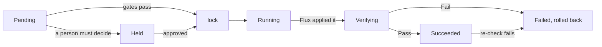

# Pacto delivery

Pacto delivery decides which version each environment runs. It uses your
contracts to work out whether a change is safe, who must agree when it is not
and when to roll back. Flux applies the result.

Delivery is opt-in. Everything else Pacto ships never changes what runs, and
installing it grants no right to. Delivery is the one part that does, so it is
a separate chart (`pacto-delivery`) with its own image, CRDs, service account,
RBAC and admission policies. The `pacto-operator` chart gains nothing.

!!! warning "Alpha"
    The API group is `delivery.pacto.trianalab.io/v1alpha1`.

## How it works

A **Stage** is one service in one environment. It names the Flux
`OCIRepository` that applies it, and its `status.pointer` is the artifact
digest the environment runs. Only the promoter moves the pointer, and it only
ever writes one field of an object it does not own: `spec.ref.digest`.

Every change is an **Operation**, a request whose spec never changes after it
is created. The promoter carries it through these steps:



- **Before it moves**, `pacto.published` admits only a version
  [`pacto publish`](../../publishing.md) published, `pacto.diff` compares the
  running contract with the new one and `pacto.impact` projects the change onto every consumer running in
  the Stage's environment that declares a compatibility range. A consumer the new version breaks holds the
  change, routes the question to that consumer's owners and the plan says
  [which service must move first](#when-another-service-must-move-first).
  Anything Pacto cannot see (an artifact with no contract, a Pacto it cannot
  read, a registry that does not answer within 10 seconds) holds it for a
  person to accept the unknown. Unknown never passes.
- **After Flux applies it**, the Pacto contract check is the verify gate. It
  counts only when the Pacto evaluated exactly this version: the contract
  digest in `status.evaluatedRevision` is the one the artifact names and the
  workload generation it read is current. `Compliant` and `Warning` pass,
  `NonCompliant` and `Invalid` fail, anything else is Unknown.
- **Health checks and claim checks** can join the contract check, and the
  checks keep running after release. See
  [Health checks and claims](delivery-health.md).
- **Every operation that ends** gets a signed record in the registry when
  the recorder is on. See [Signed records](delivery-records.md).
- **A failed version** is remembered on the Stage and never promoted again. The
  promoter raises one rollback per failure. If that rollback fails too, or the
  outcome cannot be established, the Stage freezes until a person unfreezes it.

A Stage with `auto: true` promotes the newest eligible candidate by itself:
the digest of a candidate `OCIRepository`, or the newest version an upstream
Stage verified. A person's rollback puts an auto-hold on the Stage, so
automation does not undo it.

## Install

The chart needs Flux (source and kustomize controllers) and the Pacto operator.
Install the published chart at the same version as your operator:

--8<-- "integrations/kubernetes/docs/generated/_delivery-install-command.md"

The chart's default image is `ghcr.io/trianalab/pacto/delivery` at the chart's
`appVersion`, signed by the release workflow like the operator image. See
[Published artifacts](artifact-hub.md) to verify it.

To run an unreleased change, build the image from the repository root and
install the chart from the checkout:

```bash
docker build -f integrations/kubernetes/Dockerfile --build-arg CMD=cmd/delivery \
  -t registry.example.com/pacto-delivery:dev .
helm install pacto-delivery integrations/kubernetes/charts/pacto-delivery \
  -n pacto-delivery --create-namespace \
  --set image.repository=registry.example.com/pacto-delivery --set image.tag=dev
```

Then bind `pacto-delivery-agent` to your agents' own service accounts and
`pacto-delivery-approver` to the people who may approve.

## Upgrading

Helm installs the delivery CRDs on the first `helm install` and never updates
them, so apply the new ones before you upgrade the chart. The URLs are pinned
to the release these docs describe:

--8<-- "integrations/kubernetes/docs/generated/_delivery-crd-apply.md"

Then upgrade the release:

--8<-- "integrations/kubernetes/docs/generated/_delivery-upgrade-command.md"

Upgrading the operator never touches these CRDs; see
[Upgrade the Kubernetes operator](upgrade.md) for its own steps.

## Set up a Stage

A Stage promotes only versions `pacto publish` published: the deploy artifact
it signed, whose `pacto.dev/contract` annotation names the contract. The
candidate `OCIRepository` follows the deploy artifact's repository and sets
`spec.verify` with the publisher's identity, so Flux checks each signature
against it. The Stage remembers every digest Flux verified there in
`status.published`, and refuses anything else as `NotPublished`, a promote an
agent proposes included. A Stage with no candidate source promotes nothing, and
neither does one whose `spec.verify` names no identity: without a `secretRef`
or a `matchOIDCIdentity`, Flux accepts a keyless signature from anyone.

Such a Stage says so. Its `Ready` condition is `False` and its reason names
what is missing: `CandidateUnverified` (no `spec.verify` naming the publisher),
`CandidateNotFound` or `NoCandidateSource`. `kubectl get stage` shows it in the
`READY` column, and `kubectl wait --for=condition=Ready stage/payments` waits
until it is fixed.

```yaml
apiVersion: source.toolkit.fluxcd.io/v1
kind: OCIRepository
metadata: {name: payments-candidates, namespace: test}
spec:
  url: oci://registry/apps/payments
  ref: {semver: ">=0.0.0"}
  verify: {provider: cosign, secretRef: {name: cosign-pub}}
```

For keyless signing, name the identity and issuer the contract's `publish.sign`
declares:

```yaml
  verify:
    provider: cosign
    matchOIDCIdentity:
      - issuer: "^https://token.actions.githubusercontent.com$"
        subject: "^https://github.com/acme/payments/.github/workflows/release.yml@refs/heads/main$"
```

Label the `OCIRepository` that applies the Stage, so admission keeps everyone
but the promoter and break-glass off its digest, give it the same
`spec.verify` and create the Stage. A downstream Stage takes only the versions
its upstream lists in `status.offered`: each passed the published gate there
and verified. A version a person let through by accepting an unknown published
verdict runs there but is never offered on. An upstream Stage that does not
exist, or that the promoter may not read, offers nothing:

```yaml
apiVersion: delivery.pacto.trianalab.io/v1alpha1
kind: Stage
metadata:
  name: payments
  namespace: prod
spec:
  service: {name: payments}
  environment: prod
  applyRef: {name: payments}
  candidates:
    upstreamStage: {name: payments, namespace: test}
  auto: true
  gates:
    verify: {window: 5m}
```

## Plan, propose and approve

```bash
pacto delivery plan -n prod --stage payments --to sha256:...
pacto delivery propose -n prod --stage payments --to sha256:... --intent-digest sha256:...
pacto delivery get -n prod <operation>
pacto delivery approve -n prod <operation> --decision approve
```

`plan` predicts what the promoter will do: each gate's verdict, whether a
person must decide and the one question they would be asked. `propose` with
the plan's intent digest refuses with `PlanStale` if anything moved since.
`cancel` works until the pointer moves; after that, propose a rollback with
`--type rollback --undoes <operation>`. A tag is refused, and the refusal names
the digest it resolves to.

Agents get the same tools over MCP with `pacto mcp --delivery`:
`pacto_delivery_operation_types`, `_describe`, `_plan`, `pacto_delivery_get`,
`_explain` and `_history` for anyone, plus `_propose` and
`pacto_delivery_cancel` only when the apiserver says the caller is an agent.
There is no approve tool. Over stdio the server runs beside the agent, under
its own credentials. Over HTTP each request acts as its own caller; see
[sign-in, approvals and agents](delivery-identity.md).

## When another service must move first

A new version can break a service that uses it. Say `payments` 3.0.0 is a
breaking change and `orders` 1.8.0 runs in prod, declaring that it accepts
`payments` `^2.0.0`. The promote of `payments` to prod waits, and its plan
names what must move first:

```text
move first: orders 1.8.0 runs in prod and accepts payments ^2.0.0, not 3.0.0. orders 1.9.0 (sha256:4f1c...)
accepts it (>=2.0.0 <4.0.0) and was verified on test/orders. Ship orders first: promote sha256:4f1c... on Stage prod/orders.
```

Pacto works this out from the contracts and the Stages:

- **Only consumers in that environment count.** Pacto places a Pacto from
  where it runs. A `delivery.pacto.trianalab.io/environment` label on the Pacto
  names its environment. Without one, a Pacto runs in an environment when a
  Stage of that environment applies into its namespace: the Flux Kustomization
  that applies the Stage's `applyRef` sets `targetNamespace` to it. Where a
  Stage object lives places nothing. A Pacto that cannot be placed counts in every
  environment, and so does every Pacto when the Stages or the Kustomizations
  cannot be listed. Pacto never leaves out a consumer it cannot place.
- **The candidate must accept both versions.** Pacto looks at the versions the
  consumer's upstream Stage offered and verified, newest first, and picks one
  whose contract accepts the provider version running now and the new one. A
  version that accepts only the new one would break the moment it ships, so it
  is not a candidate.
- **The candidate must fit what else runs there.** Every other dependency the
  candidate declares must accept the version running in that environment. A
  required dependency Pacto sees nothing of there makes the answer unknown,
  and so does an optional one while the graph is partial.
- **The candidate must keep its own consumers.** Every Pacto running there that
  declares a range on the consumer must accept the candidate's version, so
  following the order never needs a person to approve a break of its own. A
  range Pacto cannot read makes the answer unknown.
- **The candidate must be newer.** A version older than the one running there,
  or one that already ran on that Stage, would roll the consumer back, so it is
  not a candidate.
- **It says what it cannot see.** If the graph is partial, a range cannot be
  read, no Stage or more than one delivers the consumer there or a candidate's
  contract cannot be read, the plan says so instead of guessing an order. All
  the registry reads for one plan's order share one 10 second limit, and what
  it did not get to read is listed as unknown.

`pacto delivery plan`, `pacto delivery explain`, the
`pacto_delivery_operation_plan` MCP tool and the Operation's `status.plan`
all carry it. In the dashboard, the inbox says which service to update first
on each held change, and the change page lists them under **Update these
first**. Both link to the consumer's Stage and, when there is one, to the Stage
that verified the version that can go first. While a change waits, the
promoter plans its order again, so a consumer that has moved drops out and a
read that timed out is tried again. Once nothing holds the change, its question
says so. Once the change has shipped, the dashboard stops showing it. In JSON it is `order.moveFirst[]`: the consumer,
the version running there and the range it declares, its `stage`, the
`candidate` (digest, version, range and the Stage that verified it) or
`unknown` (why Pacto cannot tell) and a plain `message`. `order.unknown` lists what kept Pacto from
seeing every consumer.

Pacto only says what moves first. It never promotes the other service itself:
an agent or a person proposes the consumer's promote, then plans the
provider's again. A person can still approve shipping the provider anyway.

## Who may do what

| Identity | May | May not |
|---|---|---|
| Agent (its own service account or the `pacto:agents` group) | propose, read and cancel operations | approve, unfreeze, write status, edit the pointer |
| Person | the above, plus approve (a question their team is asked) and unfreeze | write status |
| Break-glass (`pacto:break-glass`) | override and edit `spec.ref.digest` | |
| Promoter | write status and raise its own operations | sign or push |
| Recorder | write `status.record`, `status.stream.recordedSeq` and `head`, and the record finalizer; sign and push records | anything else |

An approval is bound to the operation's uid and intent digest. Admission
requires `spec.by` and `spec.groups` to be the requesting user's and
`spec.authTime` to be the login time in `userInfo.extra["pacto.dev/auth-time"]`,
which structured authentication maps from the OIDC `auth_time` claim. The
promoter refuses a login older than 15 minutes, an approval from the
operation's own actor and one from outside the teams the question names.
An agent holding a person's credentials cannot be told apart from that person;
this raises the bar, it does not close the gap.

A break-glass edit of the pointer is never undone. The promoter records it as
a witnessed override, adopts it and freezes the Stage.

## Limitations

- Without the recorder, an operation keeps its record finalizer until it is
  deleted; the promoter then lets it go.
- Stage approval policy is `approval.always`, not an expression.
- Compatibility comes from the version range each consumer declares. Pacto
  does not know which fields or endpoints a consumer uses, and the calls it
  observes say only which service calls which.
- Pacto places a Pacto in an environment by its label or by the namespace a
  Stage's Kustomization applies into. A Pacto in a namespace that a Stage of
  one environment applies into is placed there, even if you deployed it into
  that namespace for another environment by other means. Label such a Pacto
  with `delivery.pacto.trianalab.io/environment`. A Kustomization with no
  `targetNamespace` places nothing, so the Pactos it applies count in every
  environment.
- History reads the operations still in the cluster, so it is partial.
- One cluster, Flux only.
- Flux checks the signatures, so a digest it never verified on the candidate
  source cannot be promoted, even if `pacto publish` signed it.
- In the dashboard, a change's timeline shows only the times on the operation,
  not Kubernetes events. The services it affects are links to their own pages
  on the operational graph, not drawn on a graph inside the change.
- The dashboard's published versions are the ones your Stages know about, from
  their candidate sources and status. A version you published that no Stage
  has seen yet is not listed.
