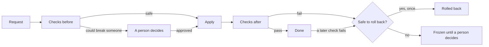

# Delivery

Pacto delivery decides which version of each service runs in each
environment, such as test and prod. It uses your contracts to tell a safe
change from a risky one, asks a person only when it must and rolls back a
version that fails its checks. A contract is the file, `pacto.yaml`, in which
each service says what it offers and which other services it calls. Flux, a
tool that keeps your Kubernetes cluster running what your files say, does the
actual switch from one version to the next (Argo CD can do it instead).

Delivery is opt-in. It is a separate install, and without it Pacto never
changes what runs. To set it up for a service, [pactify it](../../pactify.md):
give it a contract and connect it to delivery.

!!! warning "Alpha"
    Delivery is new: its settings and commands may still change.

## What happens to a change

A change is a request such as "run payments 2.4.0 in prod". A person, your build
pipeline or an AI agent can ask for one. Every change takes the same path:

**Before it moves**, Pacto checks that this version was published with
`pacto publish`, Pacto's release command, and signed, which proves who
published it. It compares the new contract with the one running and looks at
every service in that environment that uses this one. If none of them would
break, the change goes ahead on its own.

**After Flux applies it**, Pacto checks that the running version does what its
contract says. You can add health checks too, such as error rates from your
monitoring. These checks keep running after release, so a problem found an
hour later still rolls the version back once: the version that ran before is
put back. When a person picked the failed version, there is nothing safe to go
back to, the rollback itself fails or someone else already took the name of
the rollback Pacto raises, the Stage freezes instead and waits for a person to
roll back or unfreeze it, from the dashboard or the command line.
None of a Stage's last 50 failed versions is tried again there.

## Stages and records

A version reaches prod only after it passed in the environment before it,
such as test. Each service in each environment is called a **Stage**. Moving a Stage to a new
version is called promoting it, and a Stage can promote new versions on its
own or wait to be asked.

**Every change that ends**, refusals included, can leave a signed record in
your container registry, the place your images are stored. The signature shows
the record was not changed later. Anyone can check who asked for what, who
approved and what each check said.

## Who is asked and why

Each contract says which services it depends on and which of their versions it
accepts, for example "checkout accepts payments 2.x". This is its version
range. That is how Pacto knows who a change can break.

Say payments 3.0.0 removes a field. In prod, checkout and orders still accept
only payments 2.x. The change waits, and Pacto asks the checkout and orders
teams, because theirs are the services it would break. Nobody else is asked.

Pacto also says what to update first. If checkout 1.9.0 accepts both payments
2.x and 3.0.0 and already passed in test, Pacto's plan for the change says to
ship it first. Once
checkout has moved, only the orders team is still asked.

Pacto judges this by the version range each service declares, not by which
fields or endpoints it uses. Pacto can also watch the traffic between services,
but that tells it only which service calls which, not what each call uses.

AI agents can plan, ask for and cancel the changes they asked for, but only people can approve.
To approve, a person must have signed in to the dashboard (or the cluster)
with their own company login in the last 15 minutes, and the record names them.

## What Unknown means

Every check answers Pass, Fail or Unknown. Unknown means Pacto could not see
enough to say: a service with no contract, too little monitoring data, a
registry that did not answer.

Unknown never counts as yes. The change waits for a person, who can reject it
or accept the unknown. An accepted unknown is recorded as accepted, never as a
pass.

## Where you follow it

- **The dashboard**, the web page `pacto dashboard` starts, gains a Delivery
  tab once it knows who you are (you sign in, or run it on your own machine):
  the changes waiting for your team, what each environment runs, past changes
  with who asked and who approved, and the publishes Pacto refused.
- **The command line**: `pacto delivery plan` shows what would happen before
  you ask, and `pacto delivery history` what already did.
- **AI agents** get the same tools through `pacto mcp --delivery`. MCP is the
  common way AI agents call tools. There is no approve tool.

## Reference

None of these is required reading:

- [Setup and gates](delivery-setup.md): install, Stages by hand, what moves
  first and who may do what
- [Health checks](delivery-health.md): monitoring, AI agent evals and the
  calls a service makes
- [Sign-in, approvals and agents](delivery-identity.md)
- [Signed records and history](delivery-records.md): records, key rotation,
  blame, undo and verification
- [Argo CD and several clusters](delivery-reach.md)
- [Publishing details](../../publishing.md) and the contract's
  [`publish` section](../../contract-reference/publish.md)

To see all of it run on your machine,
try the [Kubernetes demo](../../examples/kubernetes-demo.md).
