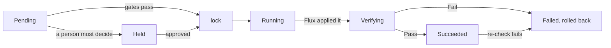

# Pacto delivery

Pacto delivery decides which version each environment runs. It uses your
contracts to work out whether a change is safe, who must agree when it is not
and when to roll back. Flux applies the result.

Delivery is opt-in. Everything else Pacto ships never changes what runs, and
installing it grants no right to. Delivery is the one part that does, so it is
a separate chart (`pacto-delivery`) with its own image, CRDs, service account,
RBAC and admission policies. The `pacto-operator` chart gains nothing.

!!! warning "Alpha"
    The API group is `delivery.pacto.trianalab.io/v1alpha1`. Signed records
    and ordering across services come later.

## How it works

A **Stage** is one service in one environment. It names the Flux
`OCIRepository` that applies it, and its `status.pointer` is the artifact
digest the environment runs. Only the promoter moves the pointer, and it only
ever writes one field of an object it does not own: `spec.ref.digest`.

Every change is an **Operation**, a request whose spec never changes after it
is created. The promoter carries it through these steps:



- **Before it moves**, `pacto.published` admits only a version
  [`pacto publish`](../../publishing.md) published, `pacto.diff` compares the
  running contract with the new one and `pacto.impact` projects the change onto every consumer that declares
  a compatibility range. A consumer the new version breaks holds the change and
  routes the question to that consumer's owners. Anything Pacto cannot see (an
  artifact with no contract, a Pacto it cannot read) holds it for a person to
  accept the unknown. Unknown never passes.
- **After Flux applies it**, the Pacto contract check is the verify gate. It
  counts only when the Pacto evaluated exactly this version: the contract
  digest in `status.evaluatedRevision` is the one the artifact names and the
  workload generation it read is current. `Compliant` and `Warning` pass,
  `NonCompliant` and `Invalid` fail, anything else is Unknown.
- **Health checks and claim checks** can join the contract check, and the
  checks keep running after release. See
  [Health checks and claims](delivery-health.md).
- **A failed version** is remembered on the Stage and never promoted again. The
  promoter raises one rollback per failure. If that rollback fails too, or the
  outcome cannot be established, the Stage freezes until a person unfreezes it.

A Stage with `auto: true` promotes the newest eligible candidate by itself:
the digest of a candidate `OCIRepository`, or the newest version an upstream
Stage verified. A person's rollback puts an auto-hold on the Stage, so
automation does not undo it.

## Install

The chart needs Flux (source and kustomize controllers) and the Pacto operator.
Install the published chart at the same version as your operator:

--8<-- "integrations/kubernetes/docs/generated/_delivery-install-command.md"

The chart's default image is `ghcr.io/trianalab/pacto/delivery` at the chart's
`appVersion`, signed by the release workflow like the operator image. See
[Published artifacts](artifact-hub.md) to verify it.

To run an unreleased change, build the image from the repository root and
install the chart from the checkout:

```bash
docker build -f integrations/kubernetes/Dockerfile --build-arg CMD=cmd/delivery \
  -t registry.example.com/pacto-delivery:dev .
helm install pacto-delivery integrations/kubernetes/charts/pacto-delivery \
  -n pacto-delivery --create-namespace \
  --set image.repository=registry.example.com/pacto-delivery --set image.tag=dev
```

Then bind `pacto-delivery-agent` to your agents' own service accounts and
`pacto-delivery-approver` to the people who may approve.

## Upgrading

Helm installs the delivery CRDs on the first `helm install` and never updates
them, so apply the new ones before you upgrade the chart. The URLs are pinned
to the release these docs describe:

--8<-- "integrations/kubernetes/docs/generated/_delivery-crd-apply.md"

Then upgrade the release:

--8<-- "integrations/kubernetes/docs/generated/_delivery-upgrade-command.md"

Upgrading the operator never touches these CRDs; see
[Upgrade the Kubernetes operator](upgrade.md) for its own steps.

## Set up a Stage

A Stage promotes only versions `pacto publish` published: the deploy artifact
it signed, whose `pacto.dev/contract` annotation names the contract. The
candidate `OCIRepository` follows the deploy artifact's repository and sets
`spec.verify` with the publisher's identity, so Flux checks each signature
against it. The Stage remembers every digest Flux verified there in
`status.published`, and refuses anything else as `NotPublished`, a promote an
agent proposes included. A Stage with no candidate source promotes nothing, and
neither does one whose `spec.verify` names no identity: without a `secretRef`
or a `matchOIDCIdentity`, Flux accepts a keyless signature from anyone.

Such a Stage says so. Its `Ready` condition is `False` and its reason names
what is missing: `CandidateUnverified` (no `spec.verify` naming the publisher),
`CandidateNotFound` or `NoCandidateSource`. `kubectl get stage` shows it in the
`READY` column, and `kubectl wait --for=condition=Ready stage/payments` waits
until it is fixed.

```yaml
apiVersion: source.toolkit.fluxcd.io/v1
kind: OCIRepository
metadata: {name: payments-candidates, namespace: test}
spec:
  url: oci://registry/apps/payments
  ref: {semver: ">=0.0.0"}
  verify: {provider: cosign, secretRef: {name: cosign-pub}}
```

For keyless signing, name the identity and issuer the contract's `publish.sign`
declares:

```yaml
  verify:
    provider: cosign
    matchOIDCIdentity:
      - issuer: "^https://token.actions.githubusercontent.com$"
        subject: "^https://github.com/acme/payments/.github/workflows/release.yml@refs/heads/main$"
```

Label the `OCIRepository` that applies the Stage, so admission keeps everyone
but the promoter and break-glass off its digest, give it the same
`spec.verify` and create the Stage. A downstream Stage takes only the versions
its upstream lists in `status.offered`: each passed the published gate there
and verified. A version a person let through by accepting an unknown published
verdict runs there but is never offered on. An upstream Stage that does not
exist, or that the promoter may not read, offers nothing:

```yaml
apiVersion: delivery.pacto.trianalab.io/v1alpha1
kind: Stage
metadata:
  name: payments
  namespace: prod
spec:
  service: {name: payments}
  environment: prod
  applyRef: {name: payments}
  candidates:
    upstreamStage: {name: payments, namespace: test}
  auto: true
  gates:
    verify: {window: 5m}
```

## Plan, propose and approve

```bash
pacto delivery plan -n prod --stage payments --to sha256:...
pacto delivery propose -n prod --stage payments --to sha256:... --intent-digest sha256:...
pacto delivery get -n prod <operation>
pacto delivery approve -n prod <operation> --decision approve
```

`plan` predicts what the promoter will do: each gate's verdict, whether a
person must decide and the one question they would be asked. `propose` with
the plan's intent digest refuses with `PlanStale` if anything moved since.
`cancel` works until the pointer moves; after that, propose a rollback with
`--type rollback --undoes <operation>`. A tag is refused, and the refusal names
the digest it resolves to.

Agents get the same tools over MCP with `pacto mcp --delivery`:
`pacto_delivery_operation_types`, `_describe`, `_plan`, `pacto_delivery_get`,
`_explain` and `_history` for anyone, plus `_propose` and
`pacto_delivery_cancel` only when the apiserver says the caller is an agent.
There is no approve tool. Over stdio the server runs beside the agent, under
its own credentials. Over HTTP each request acts as its own caller; see
[sign-in, approvals and agents](delivery-identity.md).

## Who may do what

| Identity | May | May not |
|---|---|---|
| Agent (its own service account or the `pacto:agents` group) | propose, read and cancel operations | approve, unfreeze, write status, edit the pointer |
| Person | the above, plus approve (a question their team is asked) and unfreeze | write status |
| Break-glass (`pacto:break-glass`) | override and edit `spec.ref.digest` | |
| Promoter | write status and raise its own operations | sign or push |

An approval is bound to the operation's uid and intent digest. Admission
requires `spec.by` and `spec.groups` to be the requesting user's and
`spec.authTime` to be the login time in `userInfo.extra["pacto.dev/auth-time"]`,
which structured authentication maps from the OIDC `auth_time` claim. The
promoter refuses a login older than 15 minutes, an approval from the
operation's own actor and one from outside the teams the question names.
An agent holding a person's credentials cannot be told apart from that person;
this raises the bar, it does not close the gap.

A break-glass edit of the pointer is never undone. The promoter records it as
a witnessed override, adopts it and freezes the Stage.

## Limitations

- No signed records yet. An operation keeps its record finalizer until it is
  deleted; the promoter then lets it go.
- Stage approval policy is `approval.always`, not an expression.
- History reads the operations still in the cluster, so it is partial.
- One cluster, Flux only.
- Flux checks the signatures, so a digest it never verified on the candidate
  source cannot be promoted, even if `pacto publish` signed it.
