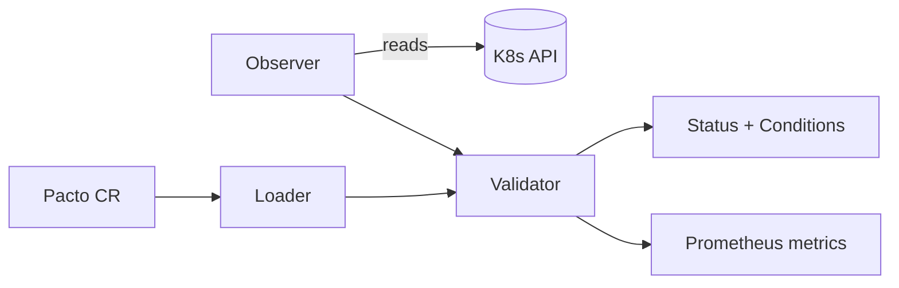

# Kubernetes integration

The Pacto operator tells you, for every service in your cluster, whether what is
running still matches its contract. You deploy with Helm or Kustomize as usual.
Nothing ties that deployment back to the contract, so the two drift apart without
anyone noticing. The operator closes that gap: you point a small `Pacto` resource
at a contract and a workload, and its status says `Compliant`, `NonCompliant` or
`Unknown`, with a finding for each problem.

```bash
kubectl get pactos -A
```

With the optional [node agent](runtime-conformance.md), Pacto also checks what
your service actually does on the network against what its contract says, and
tells you only what it can prove. It catches a pod that reports ready while
nothing listens on its port, a dependency it keeps failing to reach and a
service it calls without declaring it. The node agent is
[`pacto agent`](../../runtime-agent.md), the same watcher that checks Docker
hosts and servers, deployed on every node.

**On your workloads it only reads (`get`, `list` and `watch`); it never changes
them.** On its own components it holds more: at chart defaults it deploys
Pacto's dashboard, which means creating a Deployment, Service, ServiceAccount,
Secret and cluster-wide RBAC of its own. Those grants are broad enough to allow
privilege escalation, and turning the managed components off removes them. Read
[RBAC](rbac.md) before installing into a cluster where that matters. The
Evidence Server, the operator's other managed component, is **off** by default;
it needs `evidence.enabled=true` plus a trust store and a subject list (see
[The Evidence Server](evidence-server.md)).

## How a reconciliation works

A reconciliation is one pass in which the operator re-checks a `Pacto`
resource. It runs on every change and on a timer, and follows the same steps:

1. **Loader** resolves the contract from an OCI registry (auto-selecting the
   highest semver tag) or parses inline YAML, and snapshots each resolved version
   as an immutable `PactoRevision`.
2. **Observer** (the collector) reads runtime state from the Kubernetes API and
   turns it into evidence: typed observations of what is running. With the
   opt-in node agent it also merges kernel socket evidence (see [Runtime conformance](runtime-conformance.md) and
   [Runtime observations](runtime-observations.md)).
3. **Validator** is the engine's pure evaluator. It compares the contract with
   the evidence and returns findings (one per problem) plus coverage (what it
   could and could not check). It is stateless: the operator owns evidence
   collection and status writes.
4. **Controller** coordinates the pipeline, writes the `PactoRevision` snapshots
   and updates the `Pacto` resource status with structured conditions, a contract
   compliance status and Prometheus metrics.

The revisions in step 1 accumulate, and they are keyed by content rather than by
time. The name is `<pacto>-<version>-<7 hex of the sha256 of the contract YAML>`,
and the controller looks it up before creating it. Reconciling the same bytes a
thousand times therefore produces one `PactoRevision`. Republishing a different
contract under the same tag produces a second one alongside it, which is how a
mutated tag becomes visible after the fact. `status.currentRevision` names the
one in force. Each revision is set as a child of its `Pacto`, so deleting the
`Pacto` garbage-collects its whole history with it. Nothing else prunes them, so
a long-lived resource whose contract changes often keeps every distinct version
it has ever seen.



## What it reports

The operator sets `status.contractStatus` on each `Pacto` resource to one of six
values (`Compliant`, `Warning`, `NonCompliant`, `Reference`, `Unknown`,
`Invalid`), derived from the findings. It measures whether the service matches
its contract, not whether it is healthy. The schema (CRD) accepts a seventh,
[`NotEvaluated`, which the operator never writes](limitations.md#notevaluated-is-reserved).
[Runtime observations](runtime-observations.md) lists every status, finding code
and what is observed.

`Unknown` here means *checked, and one required claim of the contract could not
be decided*: a verdict about this contract. It is not the `unknown` used
elsewhere in Pacto, which describes how much of the world an **answer** saw (see
[Knowledge](../../operational-graph.md#knowledge)). The two never mix.

Alongside the status the operator exports five Prometheus gauges. The names,
labels and the scrape permission you have to grant yourself are in
[Scraping the metrics](installation.md#scraping-the-metrics).

Start with [Install the Kubernetes operator](installation.md).
