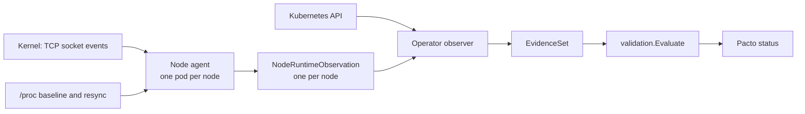

# Runtime conformance on Kubernetes

[Runtime conformance](../../runtime-conformance.md) checks what a service
does on the network against its contract, and reports only what it can
prove. On Kubernetes the operator runs it for you: it deploys
[`pacto agent`](../../runtime-agent.md) on every node as an optional DaemonSet,
the *node agent*, and merges what it sees with what the Kubernetes API says. It
is off by default.

## What you see

Take a Deployment whose readiness probe passes but whose process never opened
its port. Without the node agent, Kubernetes says the interface is up. With it,
the `Pacto` status says:

```yaml
contractStatus: NonCompliant
findings:
  - code: INTERFACE_ABSENT
    severity: error
    subject: interface/api
    evidenceRefs:
      - source: k8s
        collector: k8s-observer+ebpf    # the kernel decided this result
        observedAt: "2026-10-18T09:12:44Z"
        detectedAt: "2026-10-18T09:12:44Z"
```

The node agent adds three findings the Kubernetes API alone cannot produce:

| Finding | What happened |
| --- | --- |
| `INTERFACE_ABSENT` | endpoints are ready but no backing pod listens on the interface port |
| `DEPENDENCY_UNREACHABLE` | the pod only fails to connect to a declared dependency |
| `DEPENDENCY_UNDECLARED` | the pod talks to another Pacto service that no dependency declares (a warning) |

When the kernel view is incomplete, Pacto says so with `Insufficient`, `Stale`
or `Failed`. Silence is never a violation.

Three more checks need no node agent: the interface protocol, how far an
interface is exposed and which version a dependency runs. They are listed under
[complementary checks](#complementary-checks).

## Turn it on

You need, on every node that runs target pods:

- Linux 5.11 or later with BTF. The agent pod has no `SYS_RESOURCE`
  capability, so on 5.8 to 5.10 the program loads only when the container
  runtime's RLIMIT_MEMLOCK already covers its maps. Otherwise the node reads
  `Failed`. BTF is type information the kernel publishes at
  `/sys/kernel/btf/vmlinux`; current distribution kernels ship it. The agent
  runs on `kubernetes.io/os: linux` nodes only.
- The agent needs `hostPID`, the node's `/sys/fs/cgroup` read-only, root and
  the `BPF`, `PERFMON` and `SYS_PTRACE` capabilities; everything else is
  dropped. Only the privileged Pod Security level admits that, so it runs in
  its own namespace (`nodeAgent.namespace`, default `pacto-node-agent`), which
  the chart creates privileged. The release namespace keeps its own level.

```yaml
nodeAgent:
  enabled: true          # also turns on controller kernel evidence
controller:
  enableProbing: true    # the protocol fact; also active health probing
```

`nodeAgent.publishInterval` sets how often the agent reports.
`controller.kernelEvidence.namespace` and `staleness` cover an agent you run
yourself. Turning the agent off removes its namespace and everything in it. The
[Helm reference](helm-reference.md) lists every value.

## What the node agent observes

The agent is a DaemonSet (one pod per node) that the operator creates in the
agent namespace. Each pod runs `pacto agent --sink kubernetes` from the Pacto runtime
image (`ghcr.io/trianalab/pacto/dashboard`, the image the Evidence Server runs;
`--node-agent-image` overrides it). It uses eBPF: a small program the kernel
runs safely when an event happens. The program hooks the kernel tracepoint `inet_sock_set_state`, which
fires when a TCP socket changes state, and keeps four events:

- a socket starts listening;
- a listening socket closes;
- an outbound connection is established;
- an outbound connection fails before it is established.

Each event is matched to a pod through the cgroup that created the socket, which
names the pod, or else through its network namespace, the private network stack
every pod gets. The agent maps network namespaces to pod UIDs by reading
`/proc`: a process's cgroup path names its pod, and its `ns/net` link names its
network namespace. It also reads the listening sockets from `/proc` at
start and again every resync (60 seconds by default), so an event lost in
between heals at the next resync.

The agent keeps its node's view in a `NodeRuntimeObservation` object named
after the node. The view holds, per pod,
its listeners and, per peer address and port, the count of successful and failed
connections and when each last happened. Peers expire ten minutes after their
last attempt.

Every publish interval (30 seconds by default) it renews a Lease named after
its node, the heartbeat the operator reads, and rewrites the object only when
the view changed ([details](limitations.md#node-agent-heartbeat-and-identity)).

## What it collects

The node agent collects what every `pacto agent` collects (see
[what Pacto watches](../../runtime-conformance.md#what-pacto-watches)). It opens
no port, and its Role lets it write only `NodeRuntimeObservation` objects and
Leases in the agent namespace, so its evidence never leaves the cluster API.

An admission policy keeps each agent to the objects named after its own node
([details](limitations.md#node-agent-heartbeat-and-identity)).

## How the evidence flows



Each time the operator checks a `Pacto`, it lists the target workload's running
pods, finds each pod's node object and merges what it says into the interface
and dependency observations. The result is one `EvidenceSet` (the list of
observations about the service), judged by the same engine as without the
agent. Only node objects named after their node and carrying the agent's labels
count. Node objects trigger no check of their own; the periodic requeue reads
them.

The `collector` field of a finding names where its evidence came from:
`k8s-observer` is the Kubernetes API alone, `k8s-observer+ebpf` means kernel
evidence decided or qualified the result and `ebpf` means only the kernel saw
it. The [runtime observations](runtime-observations.md) reference lists them.

## Merge rules

The kernel can confirm and, with complete coverage, contradict. Silence alone
is never a contradiction.

| Dimension | Kernel says | Result |
| --- | --- | --- |
| Interface | a ready backing pod listens on the target container port | present |
| Interface | endpoints are ready, every ready backing pod has complete coverage and none listens | absent, through the stabilization window, then `INTERFACE_ABSENT` |
| Interface | a ready pod has partial coverage, a failed node or a stale node | `Insufficient`, `Failed` or `Stale`: never present, never absent |
| Interface | a ready endpoint names no pod, or names one that is not running | `Insufficient` unless another backing pod listens: never absent |
| Interface | no ready endpoints, or a UDP or SCTP Service port | the kernel is not consulted |
| Dependency | a recent success to the provider's cluster IP or an endpoint IP, not older than the last failure | reachable |
| Dependency | a recent failure newer than the last success, and no address with a recent success | unreachable, through the stabilization window, then `DEPENDENCY_UNREACHABLE` |
| Dependency | a recent success while the provider has no ready endpoint | `Insufficient`: the kernel never overrides a Kubernetes negative |
| Dependency | no recent connection | the Kubernetes result stands, unless it is inconclusive and a node is stale or failed |
| Other Pacto services | a recent success, by the same rule, to a Service of another Pacto target that no declared dependency resolves to | `DEPENDENCY_UNDECLARED`, a warning |

The backing pods are the pods the ready EndpointSlice endpoints for the port
name, so a canary the Service selects outside the workload counts. When no
endpoint names a pod, the workload's pods stand in, and they can confirm the
interface but never contradict it.

Pacto judges connections per peer address from their timestamps and ignores the
lifetime counts. Recent means within the staleness bound below. A timestamp from
before the pod started is ignored, because a reused network namespace can carry
another pod's history. With several pods the worst coverage wins: stale, then
failed, then partial. `DEPENDENCY_UNDECLARED` is a warning, because a contract's
dependency list may be incomplete, so it never makes a contract `NonCompliant`.
Pacto skips it entirely while a declared dependency resolves
to no Pacto target, by ref or by name (a local or other non-OCI ref, or an OCI
ref no Pacto carries): that dependency could be the service the pod
reached, so reporting it would be a false positive.

## Freshness and coverage

A pod's kernel view is usable at one of four levels:

- **Complete**: the node object is fresh, collection is `Running`, the pod has
  its own network namespace, a `/proc` baseline was taken after the pod started,
  no event was dropped since and no bound was hit.
- **Partial**: readable but incomplete: collection is `Degraded`, the pod
  shares the host network namespace, it is not mapped yet or it was truncated.
- **Failed**: the node's collection state is `Failed`, which reads as
  `COLLECTION_FAILED`.
- **Stale**: no node object, or no heartbeat (Lease renewal, else
  `lastPublished`) within the staleness bound, which reads as `EVIDENCE_STALE`. The bound is three publish intervals unless
  `controller.kernelEvidence.staleness` sets one.

`Degraded` carries the reason `PodLimitExceeded`, `ResyncFailed` or
`EventsDropped`. `Failed` carries `LoadFailed`, `AttachFailed` or
`RingBufferFailed`; a kernel without BTF fails to load, and one older than 5.11
can fail to load.

## Complementary checks

These checks refine an interface or dependency the operator has already
observed. Each is judged only when that parent observation is `Observed` (and,
for interfaces, present). A check with no usable fact is listed in
`status.evaluationCoverage.unverified` and never changes the contract status, so
a cluster without probing keeps its status.

| Contract field | Fact and source | Contradiction |
| --- | --- | --- |
| `interfaces[].type` | protocol probe: the operator sends an HTTP/2 preface to the Service port and classifies the answer as `http1`, `http2`, `tls` or `other`; needs `controller.enableProbing` | `openapi` answering `other`, or `grpc` answering `http1` or `other`: `INTERFACE_PROTOCOL_MISMATCH` |
| `interfaces[].visibility` | exposure, see [how exposure is decided](#how-exposure-is-decided) | an `internal` interface (the default) that is `external`: `INTERFACE_VISIBILITY_MISMATCH` |
| `dependencies[].compatibility` | the provider's `status.contract.version` from its Pacto resource; when several targets match the ref, the one version inside the range picks the target | a version outside the range: `DEPENDENCY_VERSION_MISMATCH`, an error for a required dependency and a warning for an optional one |
| `state.persistence.scope` | a writable PersistentVolumeClaim volume in the pod template is shared when more than one pod runs at once (Deployment, ReplicaSet or StatefulSet replicas, Job parallelism); StatefulSet volume claim templates give each replica its own claim; a claim opened or mounted read-only everywhere is ignored | `local` scope with a shared claim: `PERSISTENCE_MISMATCH` |

### How exposure is decided

Exposure is `external` only on positive evidence of an address outside private
networks: a public `spec.externalIPs` entry, a `LoadBalancer` Service with no
internal load balancer annotation whose status carries a public IP or a
hostname not starting with `internal-`, or an Ingress in the Service's
namespace that routes to the port and whose status carries such an address.
Private, loopback, link-local, carrier-grade NAT and unique local addresses are
not public. Exposure is `internal` only for a `ClusterIP` Service that no
Ingress or HTTPRoute routes to. Everything else is unknown: a `NodePort`
Service (the node network may be private), an internal or address-less
`LoadBalancer`, an address-less Ingress, any HTTPRoute (the gateway's address
is not read) and a failed read. The internal annotations recognized are GKE
(`networking.gke.io/load-balancer-type` and
`cloud.google.com/load-balancer-type`: `Internal`), AWS
(`service.beta.kubernetes.io/aws-load-balancer-internal` and
`aws-load-balancer-scheme: internal`), Azure, IBM, Oracle, OpenStack and
Alibaba Cloud.

`tls`, no answer and `asyncapi` leave the type unverified. Unknown exposure
leaves visibility unverified. A `public` interface seen only in-cluster stays
unverified too, because a gateway the operator cannot see may expose it.
`shared` scope with per-replica claims stays unverified, because the shared
store may live outside the cluster. The [field coverage](field-coverage.md)
reference has the rule for every contract field.

## Resource bounds

| Bound | Value |
| --- | --- |
| CPU request and limit | 50m and 200m (`nodeAgent.resources`) |
| Memory request and limit | 64Mi and 256Mi, which also pays for the ring buffer |
| Ring buffer | 256 KiB; a full buffer drops events and counts them |
| Pods per node | 256 |
| Listeners per pod | 64 |
| Connection peers per pod and per node | 128 and 4096 |
| Peer retention | ten minutes after the last attempt |

A pod past a bound is marked truncated, which makes its coverage partial.

## Try it on kind

`make test-acceptance-kind-runtime-conformance` builds the operator, starts a
kind cluster with the node agent and runs every scenario on this page against a
real kernel, including the "ready but nothing listening" case above.
`make e2e-runtime-conformance-kind-up` does the same and keeps the cluster, so
you can run `kubectl get pactos -A` yourself. The other tests:

- `make -C integrations/kubernetes test-ebpf` loads and attaches the real
  program in a privileged container (needs Docker).
- `go test ./pkg/validation/ -run TestFieldCoverage` checks the field coverage
  inventory against the schema and the tests it names.

The [limitations](limitations.md#runtime-conformance-boundaries) page lists what
this evidence cannot see.
